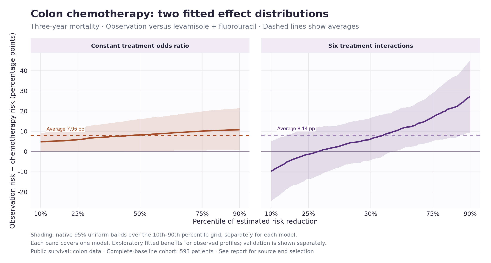
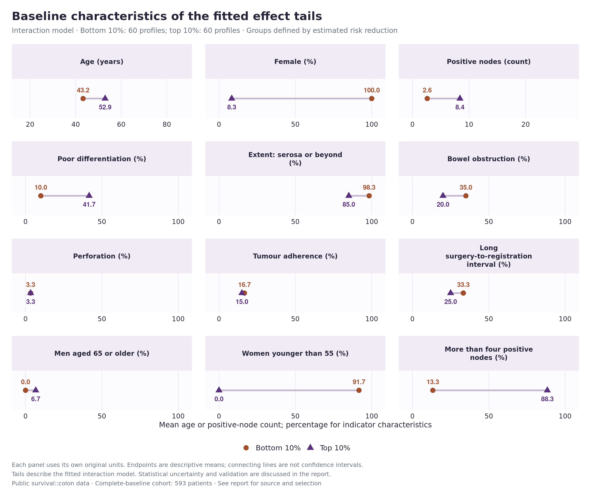
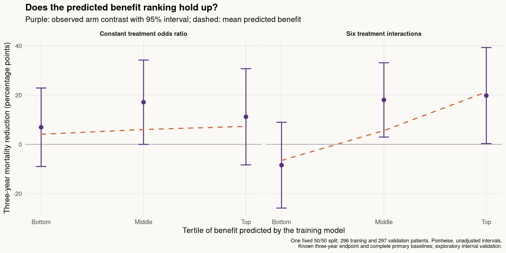

```{r}
#| label: colon_results
#| include: false
read_result <- function(name) read.csv(file.path("results/colon", name))
audit <- read_result("audit.csv")
models <- read_result("model-summary.csv")
interaction_test <- read_result("interaction-test.csv")
ape <- read_result("interaction-ape.csv")
spe <- read_result("interaction-spe.csv")
ca <- read_result("classification-stabilized.csv")
calibration <- read_result("validation-calibration.csv")
tails <- read_result("validation-tail.csv")
sensitivity <- read_result("sensitivity-interactions.csv")
sensitivity_models <- read_result("sensitivity-models.csv")
node_sensitivity <- read_result("node-coding-sensitivity.csv")
fmt <- function(x, digits = 2) formatC(x, digits = digits, format = "f")
pp <- function(x) fmt(100 * x)
pval <- function(x) format.pval(x, digits = 2, eps = .001)
model_names <- c(constant = "Common odds ratio", interaction = "Six treatment interactions")
interaction_tail <- tails[tails$model == "interaction", ]
ranking <- calibration[calibration$term == "ranking_slope", ]
interaction_ranking <- ranking[ranking$model == "interaction", ]
missing_test <- sensitivity[sensitivity$scenario == "all_known_endpoints_working_imputation", ]
```

::: {.hero}
# Colon chemotherapy: a promising ranking

The specified interaction model finds variation in estimated benefit, and its
ranking has support in one held-out sample. The missing-baseline sensitivity
is weaker. This is a useful clinical example to discuss, with **preliminary
internal evidence rather than an established treatment rule**.
:::

This analysis compares randomized levamisole plus fluorouracil with observation
after resection of colon cancer. The endpoint is **death within three years**.
The plan was written before fitting: two models, six specified interactions,
twelve classification characteristics, one validation split and three kinds
of sensitivity check. Crude arm risks and data availability had already been
inspected. This is the third trial pilot considered for this journal club;
the reported p-values do not adjust for the whole exploration.

[Analysis plan](docs/colon-analysis-plan.md) ·
[Data and exclusions](docs/colon-data.md) ·
[Analysis code](scripts/analyze-colon.R) ·
[Validation code](scripts/validate-colon-ranking.R)

## What data enter the analysis?

The public dataset has two records per person: recurrence and death. We use
one death record per person and the two selected arms. The third arm,
levamisole alone, is outside this comparison.

```{r}
#| label: colon_cohort_table
arms <- audit[audit$arm != "all", ]
knitr::kable(data.frame(
  Arm = c("Observation", "Levamisole + fluorouracil"),
  Randomized = arms$n_randomized,
  `Known three-year outcome` = arms$n_observed,
  `Deaths by three years` = arms$events,
  `Crude risk (%)` = fmt(100 * arms$observed_risk, 1),
  `Primary complete baselines` = arms$n_primary,
  check.names = FALSE
), row.names = FALSE)
```

- **619 participants** in the selected comparison; ages 18–85, with 312 women
  and 307 men.
- **618 known endpoints.** One observation-arm patient was censored early and
  has unknown three-year status. Early censoring is not coded as survival.
- **593 in the primary model and reference population.** Twelve node counts
  and thirteen differentiation grades are missing among the 618 with known
  endpoints. We report the all-618 sensitivity separately.

Among known outcomes, the crude risk reduction is
**`r pp(arms$observed_risk[1] - arms$observed_risk[2])` percentage points**.
Assigning the one unknown outcome either way gives crude differences of
`r pp(arms$risk_lower[1] - arms$risk_upper[2])` to
`r pp(arms$risk_upper[1] - arms$risk_lower[2])` pp. These are missing-outcome
bounds, not sampling confidence limits.

## Two models, similar average benefits

Both models include age, sex, age-by-sex, positive-node count, differentiation,
local extent, obstruction, tumour adherence to nearby organs and the recorded
surgery-to-registration interval. Age uses a three-degree-of-freedom natural
spline; node count uses log(1 + count).

The common-odds-ratio model has 13 coefficients. The interaction model has 19:
it adds treatment interactions with age, sex, age-by-sex, log node count, poor
differentiation and extent at least to the serosa.

```{r}
#| label: colon_models_table
knitr::kable(data.frame(
  Model = unname(model_names[models$model]),
  `Average reduction (pp)` = pp(models$average),
  `10th percentile (pp)` = pp(models$q10),
  `90th percentile (pp)` = pp(models$q90),
  check.names = FALSE
), row.names = FALSE)
```

The interaction model estimates an average reduction of
**`r pp(ape$estimate)` pp**, with a native 95% bootstrap interval of
**`r pp(ape$lower)` to `r pp(ape$upper)` pp**.
The joint six-interaction test gives **p = `r pval(interaction_test$p_value)`**.
That test concerns variation on the log-odds scale, not constancy of risk
differences.

{fig-alt="Two sorted risk-reduction curves with separate uniform bands: a common odds ratio and six treatment interactions."}

- The average benefit is similar under both specifications.
- Absolute benefit varies even under a common odds ratio, through baseline risk.
- Interactions produce a much wider fitted distribution. The lower fitted tail
  includes negative estimates, but its confidence band includes zero. This
  **does not establish treatment harm** for those profiles.
- Bands are the original package's 95% uniform bands over the displayed grid,
  separately for each model. They condition on the observed reference profiles.

## Who is in the fitted tails?

The bottom and top deciles each contain **`r ca$n_low[1]` profiles**. Both are
defined across the same 593 participants, using the fitted risk reduction
regardless of actual treatment allocation.

The bottom tail is entirely female and mostly women younger than 55. The top
tail is mostly male and has a higher mean positive-node count. These describe
the model's selected groups; they are not estimates of benefit for all women
or all men.

{fig-alt="Twelve baseline characteristics compared between the bottom and top fitted-benefit deciles, each with 60 profiles."}

- Mean age is **`r fmt(ca$low_mean[ca$variable == "age"], 1)` versus
  `r fmt(ca$high_mean[ca$variable == "age"], 1)` years**.
- Mean positive-node count is **`r fmt(ca$low_mean[ca$variable == "nodes"], 1)`
  versus `r fmt(ca$high_mean[ca$variable == "nodes"], 1)`**.
- The lines connect descriptive means; they are not confidence intervals.
- The combined demographic rows overlap with age and sex. They are not
  independent discoveries of treatment interactions.

### Classification uncertainty

The native classification bootstrap had a numerical failure in this dataset.
Its large fitting weights caused 141 of 499 logistic fits not to converge,
and 137 draws had undefined tail means. We do not use its resulting p-values.

The table below uses a **separate stabilized reconstruction** with the same
499 draws, model, weights, threshold definitions and moment formulas. Each scaled-weight
fit starts from the converged ordinary count-weight fit. All 499 then converge,
with no undefined moments or discarded draws. This numerical amendment was
recorded after the first run; it is not unmodified native package output.

```{r}
#| label: colon_classification_table
knitr::kable(data.frame(
  Characteristic = ca$label,
  `Bottom 10%` = fmt(ca$low_mean * ca$multiplier, 1),
  `Top 10%` = fmt(ca$high_mean * ca$multiplier, 1),
  `Top minus bottom` = fmt(ca$difference * ca$multiplier, 1),
  `Bootstrap SE` = fmt(ca$standard_error * ca$multiplier, 1),
  `Joint p` = format.pval(ca$joint_p, digits = 2, eps = .01),
  check.names = FALSE
), row.names = FALSE)
```

Percentage-row differences and SEs are in percentage points. Joint p-values
adjust across the twelve specified characteristics. The female and younger-women
rows are around .04 in this reconstruction; with only 499 draws and overlapping
traits, these are tentative profile differences. CA p-values do not test that
a characteristic modifies treatment effects. No native moment confidence
intervals are claimed.

## Does the ranking work in held-out patients?

One fixed split assigns **296 patients to training and 297 to validation**,
stratified on randomized treatment only. Both models are fitted on training
outcomes. Their predictions then define three equally sized benefit groups
in validation data. No alternative split was tried.

{fig-alt="Predicted and observed risk reductions across three held-out benefit groups for each model, with wide pointwise intervals."}

The interaction model predicts a top-minus-bottom tertile difference of
**`r pp(interaction_tail$predicted_difference)` pp**. The observed difference is
**`r pp(interaction_tail$estimate)` pp** (95% interval
**`r pp(interaction_tail$lower)` to `r pp(interaction_tail$upper)` pp**).
This is consistent with the predicted direction, but the interval is wide.
Its raw p-value is `r pval(interaction_tail$p_zero)` and its Holm-adjusted
p-value across the two rankings is `r pval(interaction_tail$p_holm_two_rankings)`.

```{r}
#| label: colon_validation_table
knitr::kable(data.frame(
  Model = unname(model_names[ranking$model]),
  `Ranking slope` = fmt(ranking$estimate),
  `95% interval` = paste(fmt(ranking$lower), "to", fmt(ranking$upper)),
  `Raw p (slope = 0)` = pval(ranking$p_zero),
  `Holm p (two rankings)` = pval(ranking$p_holm_two_rankings),
  check.names = FALSE
), row.names = FALSE)
```

The ranking slope regresses an AIPW benefit pseudo-outcome on frozen predicted
benefit, using training-only risk models and HC3 standard errors. A positive
slope supports agreement between prediction and validation outcomes; one
corresponds to linear calibration. The interaction slope is
**`r fmt(interaction_ranking$estimate)`**, with a 95% interval of
**`r fmt(interaction_ranking$lower)` to `r fmt(interaction_ranking$upper)`**.

The plotted group intervals are pointwise and unadjusted. The two-ranking Holm
adjustment applies separately to slopes and tail contrasts, not to every
diagnostic in this project. The full-sample interaction test and this split
check use overlapping data and are not independent replications. This is
internal validation of a model ranking, not external validation of a clinical
treatment rule.

## How sensitive is the result?

The specified sensitivity checks matter here:

- **All 618 known endpoints:** filling missing node counts with the baseline
  median of 2, retaining missing-value indicators, and representing unknown
  differentiation explicitly gives an average reduction of
  `r pp(sensitivity_models$average[sensitivity_models$scenario == "all_known_endpoints_working_imputation" & sensitivity_models$model == "interaction"])` pp.
  The six-interaction test weakens to **p = `r pval(missing_test$p_value)`**.
  This is a working missing-data analysis, not multiple imputation; both the
  model and reference population change.
- **One unknown endpoint:** assigning that person either outcome gives
  interaction-model average reductions from
  `r pp(min(sensitivity_models$average[grepl("unknown_endpoint", sensitivity_models$scenario) & sensitivity_models$model == "interaction"]))` to
  `r pp(max(sensitivity_models$average[grepl("unknown_endpoint", sensitivity_models$scenario) & sensitivity_models$model == "interaction"]))` pp.
- **Node coding:** the source's node count and binary indicator disagree for
  eight primary patients. Comparing two identical binary-node models on the
  same 593 people gives an interaction-ranking correlation of
  `r fmt(node_sensitivity$rank_correlation[node_sensitivity$model == "interaction"], 3)`.
  These binary models are sensitivity checks, not replacements selected by
  their results.

The primary and sensitivity results should be shown together. We have some
internal support for the ranking, with unresolved uncertainty about its
stability and applicability beyond this analysis population.

## What this adds to the journal club

This is a stronger candidate for the clinical story than the first two pilots:

1. The average benefit is easy to see and clinically interpretable.
2. The fitted distribution and twelve-row table make the patient profiles concrete.
3. Held-out data provide some support for the ranking, while the missing-data
   sensitivity prevents an overly neat conclusion.

The package's numerical failure is a useful optional software discussion.
For the main talk, keep attention on the clinical contrast, effect scale,
profiles and validation. These historical therapies and exploratory results
do not establish a present-day treatment recommendation or a newly discovered
clinical interaction. A focused literature check is still needed before any
novelty claim.

The source dictionary identifies the original 1990 and 1995 trial reports,
but their full text could not be retrieved here. We have not established
whether these age, sex or nodal patterns were reported previously. Our
three-year absolute-risk contrast also differs from a full time-to-event
analysis.

## Reproduce and inspect

```{.bash}
source /workspace/.tools/activate
python3 scripts/fetch-colon-data.py --verify-only
Rscript scripts/analyze-colon.R
Rscript scripts/validate-colon-ranking.R
Rscript scripts/verify-colon-inference.R
Rscript scripts/verify-colon-inference.R stabilize
Rscript scripts/plot-colon.R
quarto render colon-pilot.qmd --to html
```

Both native SPE/APE bootstrap reconstructions match exactly, including bands
and intervals. All 998 count-weight SPE fits converge. The independent audit
also reproduces the native CA failure before applying the documented
initialization change. Stable weighted fits agree with the count-weight fits
in predicted risk to within about 0.000001. These are numerical checks, not
a repeated-sampling coverage study or proof of model correctness.

[Numerical audit code](scripts/verify-colon-inference.R) ·
[All result tables](https://github.com/valentinklotzbuecher/jcod/tree/main/results/colon) ·
[Pinned data and source hashes](data/colon/README.md) ·
[IST comparison](ist-pilot.qmd)

The public data are distributed with the survival package. Its dictionary
cites Laurie et al. (1989), Moertel et al. (1990) and the final Moertel et al.
(1995) report, and documents the node-variable inconsistency. The exact
allocation algorithm and center structure have not been reconstructed here.
Inference uses working logistic models and patient-level resampling.
