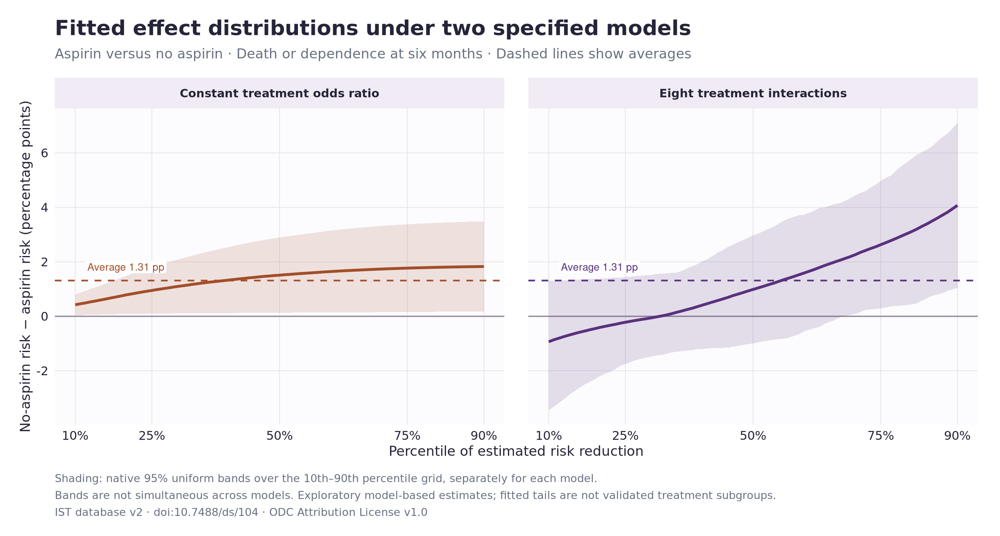
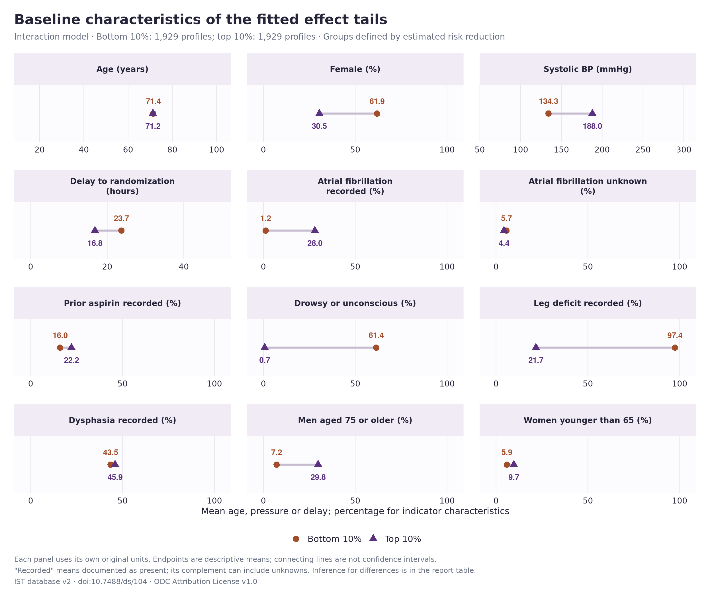
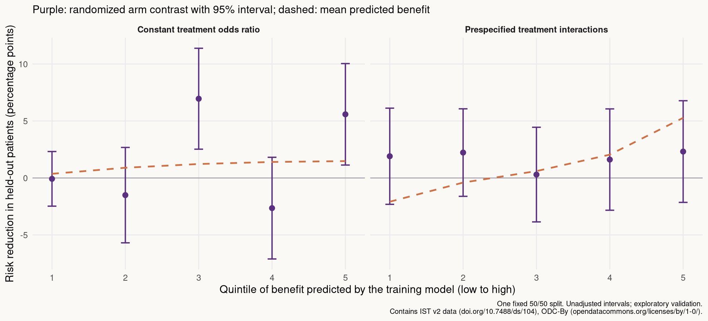

```{r}
#| label: pilot_data
#| include: false
read_result <- function(name) read.csv(file.path("results/ist", name))
audit <- read_result("outcome-audit.csv")
models <- read_result("model-summary.csv")
interaction_test <- read_result("interaction-test.csv")
constant_ape <- read_result("constant-ape.csv")
interaction_ape <- read_result("interaction-ape.csv")
ca <- read_result("classification.csv")
calibration <- read_result("validation-calibration.csv")
tails <- read_result("validation-tail.csv")
heparin <- read_result("heparin-sensitivity.csv")
constant <- models[models$model == "constant", ]
interaction <- models[models$model == "interaction", ]
interaction_validation <- tails[tails$model == "interaction", ]
constant_validation <- tails[tails$model == "constant", ]
fmt <- function(x, digits = 2) formatC(x, digits = digits, format = "f")
pp <- function(x) fmt(100 * x)
pval <- function(x) format.pval(x, digits = 2, eps = .001)
model_names <- c(constant = "Constant odds ratio", interaction = "Treatment interactions")
```

::: {.hero}
# International Stroke Trial: what does the first check show?

The interaction model gives a wider spread of fitted benefits, but its ranking
is **not convincingly supported by held-out outcomes**. A common-odds-ratio model already
produces variation in absolute benefit through baseline risk. These are useful
teaching results, with no claim of a newly established treatment subgroup.
:::

This is an exploratory reanalysis of public trial data. The model specifications,
outcome, classification characteristics and one validation split were written
down before fitting the heterogeneity models. The unadjusted arm risks had
already been inspected. [Analysis plan](docs/ist-analysis-plan.md) ·
[Data preparation and source](docs/ist-data.md) ·
[Analysis code](scripts/analyze-ist.R) ·
[Validation code](scripts/validate-ist-ranking.R)

## Data and treatment contrast

The International Stroke Trial randomized 19,435 patients to aspirin or no
aspirin, alongside randomized heparin allocation. We compare **randomized aspirin
allocation**, averaging over that heparin allocation. The endpoint is **death or
dependence at six months**, using the corrected dataset's derived `OCCODE`.

```{r}
#| label: outcome_audit_table
arms <- audit[audit$arm != "all", ]
knitr::kable(data.frame(
  Arm = c("No aspirin", "Aspirin"),
  Randomized = arms$n_randomized,
  `Outcome observed` = arms$n_observed,
  `Outcome missing` = arms$n_missing,
  `Death or dependence (%)` = fmt(100 * arms$observed_risk),
  check.names = FALSE
), row.names = FALSE)
```

The unadjusted difference among observed outcomes is
**`r pp(arms$observed_risk[1] - arms$observed_risk[2])` percentage points** in
favor of aspirin. Missing outcomes affect 150 patients (0.77%). Assigning all
missing outcomes in either direction gives an average-risk-difference range of
`r pp(arms$risk_lower[1] - arms$risk_upper[2])` to
`r pp(arms$risk_upper[1] - arms$risk_lower[2])` percentage points. That range
describes missing-outcome sensitivity; it is **not a sampling confidence interval**.

Age, sex, blood pressure and randomization delay are complete. Clinical unknowns
and unassessable deficits have explicit categories. There are no smoking or
alcohol measurements. Only baseline characteristics enter the effect models.

## Two models, the same average effect

Both models include age, sex, age-by-sex, blood pressure, delay, consciousness,
atrial fibrillation, prior aspirin, neurological deficits and stroke subtype.
Age, blood pressure and delay use natural splines. One model has a common aspirin
odds ratio. The other adds eight specified aspirin interactions with baseline
characteristics, including age-by-sex.

```{r}
#| label: model_comparison_table
knitr::kable(data.frame(
  Model = unname(model_names[models$model]),
  Parameters = models$parameters,
  `Average reduction (pp)` = pp(models$average),
  `10th percentile (pp)` = pp(models$q10),
  `90th percentile (pp)` = pp(models$q90),
  check.names = FALSE
), row.names = FALSE)
```

The interaction-model average reduction is **`r pp(interaction_ape$estimate)` pp**,
with a native 95% bootstrap interval of
**`r pp(interaction_ape$lower)` to `r pp(interaction_ape$upper)` pp**.
The joint test of the eight added interactions gives
**p = `r pval(interaction_test$p_value)`**. This tests added interactions on the
log-odds scale, rather than constancy of risk differences.

{fig-alt="Sorted fitted risk reductions under a common odds ratio and an interaction model, with separate uniform bands."}

- The two models estimate almost the same average benefit.
- Adding interactions widens the fitted distribution, including negative
  estimates for some profiles. These do not establish that aspirin harms those
  patients.
- A common odds ratio also produces a sloping SPE curve: absolute benefits vary
  with baseline risk.
- Shading shows the original package's 95% uniform band over the displayed grid,
  separately for each model. It is not a joint band over both models.

The primary regressions average over randomized heparin allocation through the
observed data. A sensitivity analysis explicitly includes heparin allocation
and averages predicted risks over its allocation proportions. The average
absolute change in individual profile predictions is
`r pp(heparin$mean_absolute_change[heparin$model == "interaction"])` pp for the
interaction model; its ranking correlation with the primary specification is
`r fmt(heparin$rank_correlation[heparin$model == "interaction"], 3)`.

## A larger classification table

These are characteristics of the **bottom and top 10% of fitted risk reductions**
from the interaction model. Each tail contains `r ca$n_low[1]` patients. They are
formed using predicted effects across both randomized arms.

```{r}
#| label: classification_table
knitr::kable(data.frame(
  Characteristic = ca$label,
  `Bottom 10%` = fmt(ca$low_mean * ca$multiplier, 1),
  `Top 10%` = fmt(ca$high_mean * ca$multiplier, 1),
  `Top minus bottom` = fmt(ca$difference * ca$multiplier, 1),
  `Bootstrap SE` = fmt(ca$standard_error * ca$multiplier, 1),
  `Joint p` = format.pval(ca$joint_p, digits = 2, eps = .01),
  check.names = FALSE
), row.names = FALSE)
```

Percentage-row differences and SEs are in percentage points. “Recorded” means
documented present; its complement can include unknown measurements. AF unknown
also identifies the pilot participants with unrecorded previous-aspirin status.

Joint p-values adjust across these **12 specified characteristics**. They test
differences in the selected tails' mean characteristics. They do not test that
a characteristic modifies treatment effects or that a treatment rule works.
The bootstrap re-estimates the model, tail thresholds and tail means. The
package does not return native confidence intervals for these moment differences.
A Monte Carlo zero is displayed as p < .01, not as an exactly zero probability.

Some descriptive gaps are large: mean systolic pressure is
**`r fmt(ca$low_mean[ca$variable == "sbp"], 0)` versus
`r fmt(ca$high_mean[ca$variable == "sbp"], 0)` mmHg** in the two tails.
After refitting and reclassification, however, **none of these 12 comparisons
has a joint p-value below .05**; the smallest is
`r fmt(min(ca$joint_p), 2)`. Large differences in the fitted table do not by
themselves establish stable treatment-benefit profiles.

{fig-alt="Twelve baseline characteristics compared between bottom and top fitted-effect deciles, with separate natural-scale axes."}

The connecting lines are descriptive differences, not confidence intervals.
The two joint demographic rows make combinations such as older men visible;
they overlap with the ordinary age and sex rows.

## Does the ranking work in held-out patients?

One fixed, treatment-stratified split uses 9,642 training patients and 9,643
validation patients. Both models are fitted using training outcomes only.
Validation patients are then grouped using frozen predicted benefits.

{fig-alt="Predicted and observed aspirin risk reductions across held-out benefit quintiles for both models."}

The interaction model predicts a top-versus-bottom quintile difference of
**`r pp(interaction_validation$predicted_difference)` pp**. In validation data,
the observed difference is **`r pp(interaction_validation$estimate)` pp**
(95% interval **`r pp(interaction_validation$lower)` to
`r pp(interaction_validation$upper)` pp**). The wide interval includes zero,
and the predicted ordering is not reproduced consistently.

```{r}
#| label: validation_table
ranking <- calibration[calibration$term == "ranking_slope", ]
knitr::kable(data.frame(
  Model = unname(model_names[ranking$model]),
  `Validation slope` = fmt(ranking$estimate),
  `95% interval` = paste(fmt(ranking$lower), "to", fmt(ranking$upper)),
  `Raw p (slope = 0)` = pval(ranking$p_zero),
  `Holm p (two rankings)` = pval(ranking$p_holm_two_rankings),
  check.names = FALSE
), row.names = FALSE)
```

The slope uses a benefit pseudo-outcome based on randomized assignment and
training-only outcome predictions, with HC3 standard errors. A positive slope
indicates agreement between the predicted ranking and validation outcomes;
a slope of one corresponds to linear calibration. The common-odds-ratio ranking
has a suggestive signal, but its quintile pattern is irregular and its adjusted
p-value exceeds .05. This does not establish a validated treatment rule.

The five plotted group intervals are pointwise and unadjusted. Holm adjustment
covers the two ranking slopes only; it does not account for every reported
diagnostic. This is one internal split, not external replication.

## What this could add to the journal club

The trial gives a concrete example of why three questions need separate answers:

1. **Does the average treatment effect favor aspirin?** The average estimated
   reduction is around one percentage point.
2. **Do fitted absolute effects vary?** Yes, even under a common odds ratio.
3. **Do added interactions give a useful, reproducible ranking?** This first
   check does not provide convincing support.

The classification table adds clinical detail, while validation limits how far
we can interpret it. A reasonable presentation would show the tempting fitted
pattern and then its uncertainty and held-out performance. A claim that a
subgroup finding is new would also require a focused literature review.

## Reproduce and inspect

### Secondary check: ACTG 175

A fixed secondary analysis compares zidovudine plus didanosine with zidovudine
alone in 1,054 participants, using 20-week CD4 count. This provides a continuous
outcome and eight baseline characteristics. Both models estimate about **71
additional CD4 cells/mm³**, with an interaction-model 95% interval of about
**58 to 84**. The joint eight-interaction test gives **p = .230**; the held-out
ranking slope gives **p = .423**. That pilot also produces fitted variation
without convincing validation of the added interaction ranking.

No additional arms, outcomes or validation splits were searched. The public
export's selection relative to the original trial cohort has not been verified.
[ACTG 175 plan, findings and classification table](docs/actg175-pilot.md) ·
[ACTG 175 analysis code](R/actg175-pilot.R)

### Run the IST analysis

```{.bash}
source /workspace/.tools/activate
python3 scripts/fetch-ist-data.py --verify-only
Rscript scripts/analyze-ist.R
Rscript scripts/validate-ist-ranking.R
Rscript scripts/plot-ist.R
quarto render ist-pilot.qmd --to html
```

The primary inference uses **SortedEffects 1.7.0**, 499 bootstrap draws, seed 420,
uncorrected estimates and the 10th–90th percentile grid. Native point estimates
are checked against direct model contrasts. The full-sample SPE band holds
original profiles and quantile weights fixed; CA uses its reweighted moment
bootstrap. The outcome model and patient bootstrap are working assumptions.
They do not establish robustness to misspecification, hospital clustering or
the trial's exact allocation algorithm. The complete-outcome analysis also
requires assumptions about the missing endpoints.

[All result tables](https://github.com/valentinklotzbuecher/jcod/tree/main/results/ist)
· [Original trial report](https://doi.org/10.1016/S0140-6736(97)04011-7)
· [Database paper](https://doi.org/10.1186/1745-6215-12-101)

Contains information from the [International Stroke Trial database, version 2](https://doi.org/10.7488/ds/104),
made available under the [ODC Attribution License](https://opendatacommons.org/licenses/by/1-0/).
The checked download is from a pinned public mirror; its provenance and hashes
are recorded in [data/ist/README.md](data/ist/README.md).
