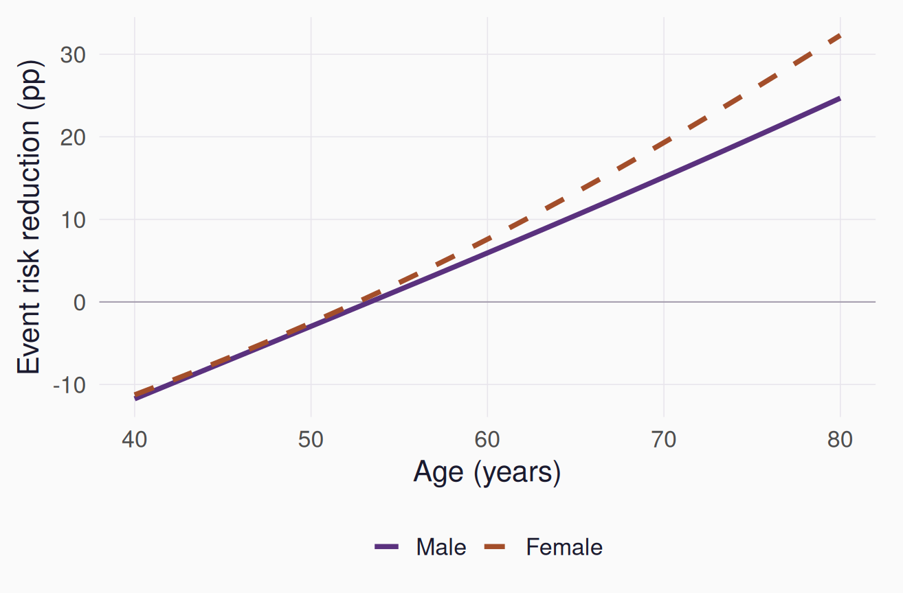

```{r}
#| label: session_data
#| include: false
required <- paste0("results/clinical-", c("spe", "inference", "ape", "profiles"), ".csv")
if (!all(file.exists(required))) {
  stop("Generate results: Rscript R/demo.R; Rscript scripts/clinical-inference.R")
}
spe_data <- read.csv(required[1])
classification <- read.csv(required[2])
ape <- read.csv(required[3])
profiles <- read.csv(required[4])
q80 <- spe_data$estimate[which.min(abs(spe_data$percentile - .80))]
pp <- function(x) sprintf("%.1f", 100 * x)
risk <- function(x) sprintf("%.1f%%", 100 * x)
```

## Session overview {#session-map .map-slide data-transition="fade"}

::: {.content-visible when-format="revealjs"}
::: {.session-map}
::: {.map-card}
[01 Literature](#literature){.map-title}

The method and the R tutorial.
:::
::: {.map-card}
[02 Example](#trial){.map-title}

Simulated treated and control groups.
:::
::: {.map-card}
[03 Sorted effects](#distribution){.map-title}

From model predictions to risk differences.
:::
::: {.map-card}
[04 Classification](#patients){.map-title}

Age and sex in the effect tails.
:::
::: {.map-card}
[05 Inference](#uncertainty){.map-title}

Confidence bands and tail comparisons.
:::
::: {.map-card}
[06 Interpretation](#decisions){.map-title}

What the analysis adds.
:::
:::

::: {.key-hint}
Left/right: chapters. Up/down: slides within a chapter. Space: next. Esc: overview.
:::
:::

::: {.content-visible when-format="beamer"}
1. Method and tutorial.
2. Simulated treated and control groups.
3. Sorted effects and characteristics of the tails.
4. Inference and interpretation.
:::

::: notes
Allow 35–40 minutes for the presentation, with discussion during a one-hour session. The same simulated dataset supports the model, figures and inference. The short R examples explain the calculations. Use the chapter map to return to a figure during discussion. Space follows the full sequence, while Esc or O opens the two-dimensional overview.
:::

# Method and literature {#literature .chapter-slide data-chapter-label="Literature" data-background-color="#261b37" data-background-transition="fade"}

::: {.chapter-number}
01
:::

::: {.chapter-lead}
Sorted partial effects describe how model-based effects vary across a population.
:::

::: {.chapter-cue}
The original method and an applied R tutorial
:::

## The method and the tutorial

- **Chernozhukov, Fernández-Val and Luo (2018):** sorted partial effects, classification analysis and inference [@chernozhukov2018].
- **Chen et al. (2020):** the R implementation, with worked examples using `spe()` and `ca()` [@chen2020].
- The model supplies a partial effect for each covariate profile. Sorting summarizes the distribution of those effects.

::: notes
The original paper allows partial effects defined as finite contrasts or derivatives. A treatment comparison is one example. A causal interpretation comes from the study design and identifying assumptions. Sorting is a way to summarize the fitted effect function. The tutorial is the most accessible starting point for this session.
:::

## What the analysis reports

| Summary | Question |
|:--|:--|
| Average partial effect | What is the mean effect across the chosen population? |
| Sorted partial effects | How large are the effects at different percentiles? |
| Classification analysis | What characterizes profiles at the lower and upper tails? |

::: {.source}
The population and the effect scale determine all three summaries [@chen2020].
:::

::: notes
Use this slide to establish the three objects before showing code. The average is the mean of the profile-specific contrasts. The SPE curve reports their quantiles. Classification returns to the covariate profiles belonging to chosen tails of that distribution. These summaries use the same fitted model.
:::

# Simulated treatment comparison {#trial .chapter-slide data-chapter-label="Example" data-background-color="#261b37" data-background-transition="fade"}

::: {.chapter-number}
02
:::

::: {.chapter-lead}
A simple example with treated and control groups, age and sex.
:::

::: {.chapter-cue}
A binary outcome and absolute risk differences
:::

## The example dataset

- **5,000 simulated participants**, randomized equally to `treated` and `control`.
- Outcome `Y = 1` is an adverse event over a common follow-up period.
- Age ranges from 40 to 80 years. Sex is binary in this teaching dataset.
- The simulated treatment effect varies with age and sex.

::: {.source}
All values and coefficients are illustrative. The example represents no specific disease or treatment.
:::

::: notes
The generic setup keeps attention on the statistical quantities. Every participant has age, sex, treatment group and a binary outcome. The data-generating model contains age-by-sex terms and their interactions with treatment. The fitted model uses that same specification. This is a favorable teaching example with known truth, rather than a demonstration of robustness to model misspecification.
:::

## Benefit on the risk-difference scale

$$
\Delta(x)=\Pr(Y=1\mid A=0,X=x)-\Pr(Y=1\mid A=1,X=x).
$$

- `A = 0` is control. `A = 1` is treated.
- **Positive:** lower event risk under treatment. **Negative:** higher event risk.
- Multiplying the contrast by 100 gives **percentage points (pp)**.
- This is a conditional average contrast for a covariate profile.

::: notes
Randomization, consistency and treatment support justify the causal comparison in this simulated setup. The model estimates average risks for profiles with the same covariates. It does not recover each person's realized individual treatment effect. In an observational application, exchangeability would need its own justification. The same sign convention is used in every plot and package call.
:::

## Two profiles from the fitted model {#same-treatment}

Both profiles have `female = 0` and differ only in age.

```{r}
#| label: example_profiles
profile_table <- data.frame(
  Profile = profiles$profile,
  `Control risk` = risk(profiles$risk_control),
  `Treated risk` = risk(profiles$risk_treated),
  `Benefit (pp)` = pp(profiles$benefit),
  check.names = FALSE
)
knitr::kable(profile_table, row.names = FALSE)
```

- Predict both treatment conditions for the same baseline profile.
- Subtract treated risk from control risk.
- Repeat this calculation for every profile in the dataset.

::: notes
Read the probabilities before the contrasts. These are two predictions from one fitted model, not paired observed outcomes. The displayed values come directly from the simulation output, so the table and subsequent figures use identical estimates. The two ages are 45 and 75 years. Sex is held fixed to make the age comparison easy to follow.
:::

# Model and sorted effects {#distribution .chapter-slide data-chapter-label="Effects" data-background-color="#261b37" data-background-transition="fade"}

::: {.chapter-number}
03
:::

::: {.chapter-lead}
The outcome model gives a risk difference for every observed age and sex profile.
:::

::: {.chapter-cue}
Predictions, absolute benefits and their distribution
:::

## R: the outcome model {.code-slide}

```{.r code-line-numbers="1|3"}
fm <- outcome ~ group * age_z * female

fit <- glm(fm, data = trial, family = binomial())
```

- `age_z = (age - 60) / 10`.
- `*` includes main effects, pairwise interactions and the three-way interaction.
- The age pattern of the treatment odds ratio can differ by sex.

::: notes
This specification matches the simulated data-generating model. Group is a factor with control as its reference level. The full hierarchical interaction includes group-by-age, group-by-sex, age-by-sex and group-by-age-by-sex terms. Probability differences depend on both these terms and baseline risk. In an applied analysis, the model should follow the scientific question, available sample size and model diagnostics.
:::

## R: predictions under both groups {.code-slide}

```{.r code-line-numbers="1-3|5-6"}
control <- treated <- trial
control$group <- "control"
treated$group <- "treated"

benefit <- predict(fit, control, type = "response") -
  predict(fit, treated, type = "response")
```

- Keep each profile's age and sex fixed.
- Change only its treatment group.
- `type = "response"` returns probabilities.

::: notes
Every participant contributes one profile, regardless of their actual randomized group. We predict their risk under both conditions and subtract the probabilities. This is standardization over the observed profiles. The resulting vector contains model-based conditional average benefits for all 5,000 profiles.
:::

## Fitted benefit by age and sex {.figure-slide}

::: columns
::: {.column width="64%"}
{width=100%}
:::
::: {.column width="33%"}
- The horizontal axis is **age**.
- Each line shows the fitted risk reduction for one sex.
- Values above zero favor treatment. Baseline risk and treatment interactions both shape the curves.
:::
:::

::: {.source}
Simulated data. Benefit is control risk minus treated risk, in percentage points.
:::

::: notes
This plot keeps the connection between the effect and its covariates visible. Each point is a model prediction at a given age and sex. The next step will place the 5,000 observed-profile contrasts in numerical order. The sorted plot's horizontal axis will be percentile, not age. A long sorted curve can combine profiles of different ages and sexes.
:::

## R: the mean and the sorted effects {.code-slide}

```{.r code-line-numbers="1-4|5"}
u <- seq(.10, .90, by = .01)
spe_curve <- Hmisc::wtd.quantile(
  benefit, weights = rep(1, nrow(trial)), probs = u
)
mean(benefit)
```

- The **mean** averages all 5,000 profile-specific benefits.
- The **SPE curve** reports quantiles of those same benefits.
- We display the central 10th–90th percentiles.

::: {.source}
The weighted-quantile convention matches SortedEffects 1.7.0.
:::

::: notes
Equal weights give each observed profile the same contribution. The mean is over the full population, not just the displayed percentile range. The average also differs from the median, which is one point on the sorted curve. Changing the reference population can change these summaries even when the conditional model stays the same.
:::

## Sorted effects and the average {.figure-slide}

::: columns
::: {.column width="64%"}
{width=100%}
:::
::: {.column width="33%"}
- The horizontal axis is the **percentile of estimated benefit**.
- The vertical axis shows risk reduction in **percentage points**.
- The dashed line is the mean: **`r pp(ape$estimate)` pp**.
:::
:::

::: {.source}
The curve increases because the effects have been sorted. Its shape alone is not a test of heterogeneity.
:::

::: notes
First locate zero, then the average, then the lower and upper parts of the curve. Each point reports a quantile of the fitted profile-specific contrasts. The dashed average can lie above or below the median. The confidence band later in the presentation adds sampling uncertainty. The increasing shape is a property of sorting; it is not an empirical finding that treatment benefit rises along a natural time or age axis.
:::

## Interpreting the 80th percentile

The estimated 80th percentile is **`r pp(q80)` pp**.

- Approximately 80% of the observed profiles have estimated benefits at or below this value.
- The remaining 20% have larger estimated benefits.
- This is a quantile of conditional effects. A quantile treatment effect compares outcome quantiles.

::: notes
A percentile of benefit also differs from the probability that a particular person benefits. Keep this distinction explicit once, then use the term profile-specific conditional benefit consistently. The 80th percentile value is generated automatically from the same SPE output as the curve.
:::

# Characteristics of the effect tails {#patients .chapter-slide data-chapter-label="Classification" data-background-color="#261b37" data-background-transition="fade"}

::: {.chapter-number}
04
:::

::: {.chapter-lead}
Classification analysis describes the profiles with the smallest and largest estimated benefits.
:::

::: {.chapter-cue}
The lowest and highest 10%
:::

## R: selecting the benefit tails {.code-slide}

```{.r code-line-numbers="1-3|4-7"}
cutoff <- Hmisc::wtd.quantile(
  benefit, rep(1, nrow(trial)), c(.10, .90)
)
groups <- list(low = benefit <= cutoff[1],
               high = benefit >= cutoff[2])
lapply(groups, function(i)
  colMeans(trial[i, c("age", "female")]))
```

- Rank profiles by their estimated benefit.
- Select the lowest and highest 10%.
- Compare their mean age and proportion female.

::: notes
These groups are defined by fitted benefit. They can contain both treated and control participants. They are not the randomized groups and are not defined by the observed outcome. With continuous contrasts, the thresholds select about 10% each. Ties at a cutoff require an explicit convention and may change group sizes. This calculation gives descriptive endpoints; inference comes later.
:::

## Age and sex in the two tails {.figure-slide}

::: columns
::: {.column width="64%"}
{width=100%}
:::
::: {.column width="33%"}
- Each dot is a **tail mean**: age or percentage female.
- The line connects the lowest- and highest-benefit groups.
- The panels use different units. The line length is descriptive.
:::
:::

::: {.source}
Tail groups are defined by estimated benefit. The connecting lines are not confidence intervals.
:::

::: notes
Identify both endpoint colors before interpreting the plot. Age is reported in years and female as a percentage. Comparing distances across the two panels would be misleading because they have different scales. Age and sex enter the model that defined the ranking, so the tail differences reflect that fitted model. Formal uncertainty concerns the difference between tail means and is reported separately.
:::

## Tail comparisons and subgroup analyses

| Analysis | Quantity compared |
|:--|:--|
| Treatment effect within an age/sex profile | Treated and control risks at the same covariates |
| Classification analysis | Mean characteristics in low- and high-benefit tails |
| Interaction analysis | Whether the treatment contrast varies with a covariate on the model's scale |

- A tail difference describes how the ranking relates to age or sex.
- It does not by itself test a treatment interaction.

::: notes
Classification can describe an effect distribution in a compact way, especially with many covariates. It answers a different question from testing a specified interaction. Even a covariate with no treatment interaction can differ between tails through baseline risk or correlation with other covariates.
:::

## Tail membership after refitting {.figure-slide}

::: columns
::: {.column width="64%"}
{width=100%}
:::
::: {.column width="33%"}
- Start with the original **highest-benefit 10%**.
- Refit the model and reselect the tail in each bootstrap sample.
- The vertical axis is how often each original profile remains in that tail.
:::
:::

::: {.source}
A separate sensitivity diagnostic. These frequencies are not individual membership probabilities.
:::

::: notes
The horizontal ordering follows the original fitted benefit within the highest-benefit group. Profiles near the cutoff can move in or out after refitting. The transparent teaching bootstrap generates this diagnostic. Keep it distinct from the original package's formal classification inference and confidence-set methods. A frequency here describes sensitivity to refitting under the model and observed profiles.
:::

# Sampling uncertainty {#uncertainty .chapter-slide data-chapter-label="Inference" data-background-color="#261b37" data-background-transition="fade"}

::: {.chapter-number}
05
:::

::: {.chapter-lead}
Uncertainty includes model fitting and the resulting changes in the sorted effects and tail groups.
:::

::: {.chapter-cue}
SPE confidence bands and classification comparisons
:::

## R: confidence bands for the SPE curve {.code-slide}

```{.r code-line-numbers="1-5|6"}
spe_fit <- SortedEffects::spe(
  fm = fm, data = trial, method = "logit",
  var_type = "categorical", var = "group",
  compare = c("treated", "control"),
  us = u,
  b = 499, alpha = .05, bc = FALSE, seed = 420
)
```

- `spe()` estimates the curve and its bootstrap confidence band.
- `compare` gives the **control-minus-treated** contrast.
- The example uses 499 repetitions and uncorrected point estimates.

::: notes
In the categorical implementation, compare[2] minus compare[1] sets the direction. Treated then control therefore matches the positive-benefit convention. The package computes standard errors and bounds as well as the mean and sorted estimates. Bias correction is an option, but it is disabled here to keep point estimates equal to the direct prediction calculations. A final applied analysis should check Monte Carlo precision and use enough bootstrap repetitions.
:::

## Uncertainty across the sorted curve {.figure-slide}

::: columns
::: {.column width="64%"}
{width=100%}
:::
::: {.column width="33%"}
- The line is the estimated SPE curve.
- Shading is a **95% uniform band** over the displayed percentile grid.
- Compare the band with zero when assessing the direction of effects.
:::
:::

::: {.source}
SortedEffects 1.7.0, 499 bootstrap repetitions. The SPE calculation uses the observed profiles as its reference population.
:::

::: notes
A uniform band addresses the curve jointly over the selected 10th–90th percentile grid. It is wider in purpose than a pointwise interval at one chosen percentile. Where the entire band lies above zero, the corresponding conditional-effect quantile supports a positive contrast under the model and inference assumptions. This is not an interval for an individual's treatment effect. The band itself is not a dedicated global test that all effects are identical.
:::

## R: uncertainty in classification {.code-slide}

```{.r code-line-numbers="1-4|5-8"}
ca_fit <- SortedEffects::ca(
  fm = fm, data = trial, method = "logit",
  var_type = "categorical", var = "group",
  compare = c("treated", "control"),
  u = .10, interest = "moment", cl = "diff",
  t = c("age", "female"),
  b = 499, alpha = .05, bc = FALSE, seed = 420
)
```

- Compare means in the highest- and lowest-benefit 10%.
- Refit, update the thresholds and reclassify in the bootstrap.
- Adjust the reported p-values jointly across **age and sex**.

::: notes
The moment/diff output gives differences, bootstrap standard errors and joint adjusted p-values. For this path, the package applies resampled weights to the thresholds and tail means as well as the model fit. This differs from the fixed-profile SPE quantile path. The two-characteristic adjustment concerns the selected classification comparisons, not every possible exploratory model or threshold.
:::

## Estimated differences between the tails

```{r}
#| label: classification_inference_table
selected <- classification[match(c("age", "female"), classification$characteristic), ]
scale <- c(1, 100)
joint_p <- format.pval(selected$joint_p, digits = 2, eps = .001)
zero_draws <- selected$joint_p == 0
joint_p[zero_draws] <- paste0("0 / ", selected$bootstrap_draws[zero_draws])
inference_table <- data.frame(
  Characteristic = c("Age (years)", "Female (pp)"),
  `High minus low` = sprintf("%.2f", selected$difference * scale),
  `Bootstrap SE` = sprintf("%.2f", selected$standard_error * scale),
  `Joint p` = joint_p,
  check.names = FALSE
)
knitr::kable(inference_table, row.names = FALSE)
```

- **Positive differences:** higher mean age or proportion female in the high-benefit tail.
- The SE describes sampling uncertainty in the **difference**.
- Joint p-values account for these two comparisons.

::: {.source}
Native `ca()` output, 499 repetitions. “0 / 499” means zero bootstrap exceedances, rather than an exact population p-value of zero.
:::

::: notes
Read the direction and units before the p-values. Female is a difference in proportions expressed in percentage points. A small joint p-value supports a difference in a selected characteristic between the model-defined tails, under the method's assumptions. It is not a test of benefit within a subgroup. The dumbbell endpoints remain descriptive means; this table reports uncertainty in their differences. Zero exceedances are displayed as a count to show the finite Monte Carlo resolution.
:::

## Assumptions behind the estimates

- **Study design:** the treatment comparison has a defensible causal interpretation.
- **Outcome model:** the conditional risks and interaction structure are credible.
- **Reference population:** the covariate distribution matches the question.
- **Inference:** resampling reflects the design and the selected tail comparisons.

::: notes
The simulation satisfies these conditions by construction, including a correctly specified model and randomized treatment. In real data, assess model sensitivity, treatment support and the relevance of the reference population. Clustering and external standardization require suitable inference. An almost constant or degenerate effect distribution can create difficulties for ordinary smooth quantile inference. Numerical reproducibility does not establish coverage in every setting.
:::

# Interpretation and discussion {#decisions .chapter-slide data-chapter-label="Interpretation" data-background-color="#261b37" data-background-transition="fade"}

::: {.chapter-number}
06
:::

::: {.chapter-lead}
The analysis summarizes effect heterogeneity and describes where the fitted model places it.
:::

::: {.chapter-cue}
The additional evidence needed for decisions
:::

## Treatment decisions

- The sorted curve shows how much the estimated benefit varies.
- Classification describes the baseline profiles at its extremes.
- Decisions also depend on harms, burden and the benefit threshold.
- A proposed treatment rule needs evaluation in independent data.

::: notes
A ranked list does not by itself determine an optimal policy. If all profiles had positive net benefit above a relevant threshold, treating only the highest-benefit decile could be worse than treating everyone. The chosen outcome must be meaningful for the decision, and one adverse event may not represent the full balance of benefits and harms. Separate the usefulness of the descriptive summary from evidence that a rule improves decisions.
:::

## Questions for discussion

1. What does the sorted curve add to the average treatment effect?
2. When would age/sex plots or prespecified subgroup analyses be enough?
3. Which model choices would we vary in a sensitivity analysis?
4. What would we need before using an estimated ranking in practice?

::: notes
Invite the group to compare the demographic plot, sorted curve and classification table. All summarize the same model, but they emphasize different aspects. Useful follow-ups include the effect scale, uncertainty near cutoffs, omitted effect modifiers, external standardization and the tradeoff between a simple explanatory model and flexible prediction. Reserve time for participants' own examples.
:::

## Reading and resources

- **Tutorial first:** Chen et al. (2020), Sections 1, 2.2 and 2.3 [@chen2020].
- **Original method:** Chernozhukov et al. (2018), introduction and Section 2 [@chernozhukov2018].
- **Optional health application:** Pullabhotla and Souza (2022), Section 3, Figure 4 and Table 1 [@pullabhotla2022].

::: {.source}
The session page links to the papers, executable R example and inference notes.
:::

::: notes
The health application studies agricultural fires and hypertension. Its sorted-effects curve and classification table provide a useful comparison with the simulated example. The effect there is a derivative for a continuous exposure, whereas our example uses a binary treatment contrast. Appendix B.2 of the accessible author version describes the implementation. The causal argument comes from the exposure design; sorting summarizes the fitted heterogeneity.
:::

# Technical backup {#backup .chapter-slide .backup-chapter data-chapter-label="Backup" data-background-color="#261b37" data-background-transition="fade"}

::: {.chapter-number}
+
:::

::: {.chapter-lead}
Definitions, effect scales and resampling details.
:::

::: {.chapter-cue}
Optional material for questions
:::

## Definition of sorted partial effects

$$
\mathrm{SPE}(u)=Q_{\Delta(X)}(u), \qquad
\mathrm{APE}=E[\Delta(X)].
$$

- The distribution of `X` defines the population.
- The average uses that full distribution.
- Classification describes the covariates in selected effect tails.

::: {.source}
[@chernozhukov2018]. Estimated curves use the package's weighted empirical quantile convention.
:::

::: notes
A quantile of conditional effects differs from a difference between outcome quantiles. It also differs from the distribution of realized individual treatment effects. The APE is a full-population mean and should not be calculated as the average of a truncated SPE grid. Changing the reference distribution changes the summaries even if the conditional effect function is unchanged.
:::

## Effect heterogeneity depends on the scale {.figure-slide}

::: columns
::: {.column width="64%"}
{width=100%}
:::
::: {.column width="33%"}
- The odds ratio is **0.60 for every profile**.
- Absolute benefit varies with control risk.
- Risk-difference heterogeneity can occur without a treatment interaction on the log-odds scale.
:::
:::

::: {.source}
Analytic illustration, separate from the main age-by-sex interaction model.
:::

::: notes
For a control risk p and an odds ratio theta, treated risk is theta times p divided by 1 minus p plus theta times p. The absolute benefit peaks at an intermediate control risk, 1 divided by 1 plus the square root of theta. It is not globally increasing with baseline risk. This example helps separate heterogeneity on the chosen outcome scale from a changing regression coefficient or a biological mechanism.
:::

## Simulation assumptions

- Age is uniform from 40 to 80. The sex indicator is Bernoulli with probability 0.5.
- Control log odds include age, sex and their interaction.
- The treatment log odds ratio varies with age and sex.
- The fitted model matches the data-generating model.

::: {.source}
The same 5,000 observed profiles define the primary SPE population. Coefficients and seeds are in `R/demo.R`.
:::

::: notes
The simulation was chosen to make the calculations visible. The interaction intercept is calibrated so that the mean true benefit equals that of an optional constant-odds-ratio comparison. The fitted effects can still differ from the truth because of sampling variation. This example does not assess performance under model misspecification. The separate teaching bootstrap supplies the membership diagnostic.
:::

## Resampling targets

- **`spe()`:** refit using bootstrap weights, then compute quantiles with the original profile weights.
- **`ca()`:** refit, update tail thresholds and recompute characteristic means with resampled weights.
- **Membership diagnostic:** refit and track the original profiles' selected-tail membership.

::: notes
These descriptions refer to the full-sample paths in the pinned 1.7.0 implementation. They matter when interpreting what uncertainty each output represents. A broader target population or clustered observations requires an appropriate adaptation. The primary SPE plot uses the package's IQR/max bootstrap band. The transparent teaching bootstrap is separate from the package's formal classification confidence-set method.
:::

## Classification output

- `ca(..., interest = "moment", cl = "diff")` reports high-minus-low mean differences.
- Bootstrap SEs quantify uncertainty in those differences.
- Joint p-values adjust across the supplied characteristics.
- The main table uses the native SEs and joint p-values.

::: notes
The original package's pointwise p-value implementation differs from the usual doubled normal-tail formula, so the main table uses its joint adjusted output. Simultaneous confidence intervals for moment differences cannot be recovered just by treating those adjusted p-values as ordinary normal p-values. Adjustment for age and sex does not cover all exploratory choices of model, population or tail cutoffs.
:::

## The tutorial's mortgage example {.figure-slide}

::: columns
::: {.column width="64%"}
{width=100%}
:::
::: {.column width="33%"}
- Outcome: mortgage denial.
- The model compares predicted denial risks across race indicators at the same other covariates.
- The curve summarizes an adjusted observational disparity.
:::
:::

::: {.source}
Tutorial data [@chen2020; @munnell1996]. Separate benchmark with uncorrected estimates and 95% bands.
:::

::: notes
The tutorial reports a bias-corrected average disparity of 5.1 percentage points with a 90% interval from 2.1 to 8.1, using 500 bootstrap draws. This benchmark uses 199 draws, uncorrected estimates and 95% bands, so its numbers should not be described as an exact reproduction of those published interval settings. The underlying 1996 study supplied the data; the later tutorial applies the sorted-effects method. A causal interpretation of the race contrast needs additional assumptions.
:::

## References {.smaller}

::: {#refs}
:::
