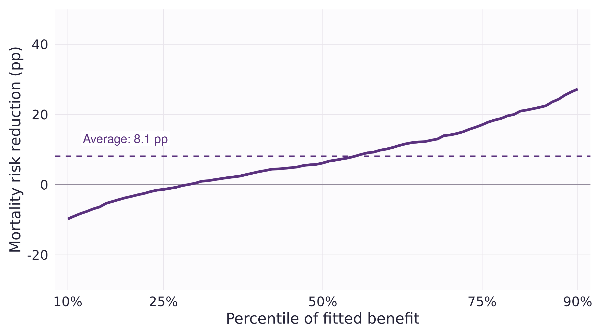

```{r}
#| label: session_data
#| include: false
spe_data <- read.csv("results/colon/interaction-spe.csv")
ape <- read.csv("results/colon/interaction-ape.csv")
classification <- read.csv("results/colon/classification-stabilized.csv")
pp <- function(x) sprintf("%.1f", 100 * x)
warmup <- read.csv("results/warmup/population-risks.csv")
warmup_means <- read.csv("results/warmup/population-means.csv")
stopifnot(all(abs(warmup_means$mean_benefit - .10) < 1e-12))
ca_table <- function(variables) {
  d <- classification[match(variables, classification$variable), ]
  labels <- c(age = "Age (years)", female = "Female (%)",
    old_men = "Men aged 65+ (%)", younger_women = "Women under 55 (%)",
    nodes = "Positive nodes", nodes_over4 = "More than 4 nodes (%)",
    poor_diff = "Poor differentiation (%)", extensive = "Serosa or beyond (%)",
    obstruct = "Bowel obstruction (%)", perfor = "Perforation (%)",
    adhere = "Tumour adherence (%)", surg_late = "Long surgery interval (%)")
  knitr::kable(data.frame(
    Characteristic = unname(labels[d$variable]),
    Low = sprintf("%.1f", d$low_mean * d$multiplier),
    High = sprintf("%.1f", d$high_mean * d$multiplier),
    Difference = sprintf("%+.1f", d$difference * d$multiplier),
    SE = sprintf("%.1f", d$standard_error * d$multiplier),
    `Joint p` = sprintf("%.3f", d$joint_p), check.names = FALSE),
    align = c("l", rep("r", 5)))
}
```

## Session overview {#session-map .map-slide data-transition="fade"}

::: {.content-visible when-format="revealjs"}
::: {.session-map}
::: {.map-card}
[01 · Method](#literature){.map-title}

Literature and a constructed example.
:::
::: {.map-card}
[02 · Trial](#example){.map-title}

Chemotherapy and three-year mortality.
:::
::: {.map-card}
[03 · Sorted effects](#distribution){.map-title}

From predicted risks to a distribution.
:::
::: {.map-card}
[04 · Classification](#classification){.map-title}

Twelve characteristics of the two tails.
:::
::: {.map-card}
[05 · Inference](#uncertainty){.map-title}

Uncertainty and a held-out check.
:::
::: {.map-card}
[06 · Discussion](#discussion){.map-title}

What would convince us?
:::
:::
::: {.key-hint}
**→** chapters · **↓** slides within a chapter · **Space** next step · **Esc** overview
:::
:::

::: {.content-visible when-format="beamer"}
1. Method, software and a constructed example.
2. A public colon cancer trial.
3. Sorted effects and characteristics of the tails.
4. Inference, validation and discussion.
:::

::: notes
35–40 minutes of presentation and 20–25 minutes for discussion. The constructed example introduces the estimand; colon is the empirical analysis. The forest teaser is intended for a future session.

Suggested pacing (about 40 minutes): Method 6 · Trial 6 · Effects 8 · Classification 6 · Inference 10 · Discussion opener 4. If time runs short, summarize the band construction and the native-CA failure in one sentence each. Leave the discussion questions up during open discussion; close with the forest teaser.
:::

# Method and motivation {#literature .chapter-slide data-chapter-label="Method"}

::: {.chapter-number}
01
:::
::: {.chapter-lead}
The average effect is useful. What else can we learn from the same model?
:::
::: {.chapter-cue}
↓ The method and its R implementation
:::

## Two starting points

- **Applied tutorial:** *The R Journal* [@chen2020].
- **Method:** *Econometrica* [@chernozhukov2018].

::: {.sorting-steps}
::: {.fragment .fade-up}
**Average effect**

How large is the effect on average?
:::
::: {.fragment .fade-up}
**Sorted effects**

How much do the fitted effects vary?
:::
::: {.fragment .fade-up}
**Classification**

Who is in the low and high tails?
:::
:::

::: notes
For treatment, the partial effect is a finite contrast in conditional outcome means. For a continuous exposure, it can instead be a derivative.
:::

## What the R package provides

::: columns
::: {.column width="48%" .profile-card}
### `spe()`

An effect distribution and average effect, with **bootstrap confidence bounds**.
:::
::: {.column width="48%" .profile-card}
### `ca()`

Tail comparisons, with **bootstrap standard errors and joint p-values**.
:::
:::

::: {.source}
SortedEffects 1.7.0. Native SPE inference; audited numerical stabilization for colon CA (details in chapter 05).
:::


## Same average, different effect patterns {#warmup-average}

Constructed example: three equally common baseline profiles.

Both populations have **40% control risk**, **30% marginal treated risk** and **10 pp average benefit**.

::: {.fragment .fade-up}
```{r}
#| label: warmup_effect_table
#| results: asis
profiles <- c("A", "B", "C")
warmup_table <- do.call(rbind, lapply(warmup_means$scenario, function(name) {
  d <- warmup[warmup$scenario == name, ]
  values <- sprintf("%+.0f", 100 * d$benefit[match(profiles, d$profile)])
  data.frame(Scenario = name, A = values[1], B = values[2], C = values[3])
}))
knitr::kable(warmup_table, col.names = c("True benefit (pp)", "Profile A", "Profile B", "Profile C"),
             align = c("l", "r", "r", "r"), row.names = FALSE)
```

Benefit = control risk − treated risk.
:::

::: {.source}
Constructed conditional risks, not sampled trial outcomes. Control risk is 40% in each profile; treated risks are 30/30/30% or 50/30/10%.
:::

::: notes
The marginal risk contrast is identical, but the conditional contrasts differ. Profiles A–C are generic baseline groups with equal population weights. Negative benefit means higher risk under treatment. These are specified population quantities, so no estimation or confidence interval is involved.
:::

## Sorting reveals the difference {#warmup-distribution .figure-slide}

::: columns
::: {.column width="70%"}
{.panel-figure width=100%}
:::
::: {.column width="30%" .figure-notes}
- The mean is **10 pp** in both populations.
- Each step spans **one third** of the heterogeneous population.
- The lower third has **negative benefit**, despite a positive average.
:::
:::

::: {.prompt}
In the trial, the effect distribution and its uncertainty must be estimated.
:::

::: {.source}
Exact population quantiles of constructed conditional-average effects; no fitted model or sampling uncertainty.
:::

::: notes
The quantile function uses the inverse-CDF convention: at a jump, the filled point belongs to the lower step. The discrete profiles illustrate what sorting summarizes, not the regularity conditions or coverage of the inferential method. Colon provides the empirical analysis.
:::

# The trial {#example .chapter-slide data-chapter-label="Trial"}

::: {.chapter-number}
02
:::
::: {.chapter-lead}
Does chemotherapy reduce mortality by the same amount for every patient profile?
:::
::: {.chapter-cue}
↓ A public randomized trial and a defined outcome
:::

## A public colon cancer trial {#trial-data}

- Patients with resected **stage III colon cancer**, randomized to three arms.
- We compare **levamisole + 5-FU** with **observation**: 619 patients.
- Outcome: **death within three years**; known for 618 patients.
- Primary analysis: **593 patients** with complete baseline variables.

::: {.source}
`survival::colon`, death records; levamisole-only arm excluded. Trial reports [@moertel1990; @moertel1995].
:::

::: notes
Death records only. One participant was censored before three years; 25 further participants lacked node count or differentiation. Complete-case estimates target the retained cohort rather than the full randomized population.

The final report covers 929 eligible stage III (Dukes' C) patients: levamisole plus fluorouracil reduced the recurrence rate by 40% and the death rate by 33% (median follow-up 6.5 years). Levamisole alone had little effect.
:::

## Start with the average {#trial-average data-auto-animate="true"}

::: columns
::: {.column width="48%" .profile-card .fragment .fade-up fragment-index="0"}
### Observation

::: {.metric}
34.7%
:::

109 deaths / 314 patients
:::
::: {.column width="48%" .profile-card .fragment .fade-up fragment-index="1"}
### Levamisole + 5-FU

::: {.metric}
25.7%
:::

78 deaths / 304 patients
:::
:::

::: {.prompt .fragment .fade-up fragment-index="2"}
**9.1 percentage points** lower three-year mortality.
:::

::: {.source}
Crude risks: 618 known outcomes. Standardized analyses: 593 complete cases.
:::

::: notes
The crude contrast and the later standardized estimate differ in both cohort and estimation method. Assigning the single unknown outcome either way gives a crude sensitivity range of 8.95–9.26 pp, not a confidence interval.
:::

## Define benefit before sorting

$$
\Delta(x)=\Pr(Y=1\mid A=0,X=x)-\Pr(Y=1\mid A=1,X=x).
$$

- $Y=1$: death by three years; $A=0$: observation; $A=1$: chemotherapy.
- $X$: age, sex and tumour characteristics at baseline.
- **Positive:** lower mortality under treatment. **Negative:** higher mortality.
- One conditional **average** contrast per profile, not an individual's causal effect.

::: notes
Standardization uses the 593 observed baseline profiles. Changing the reference population can change both the average and the sorted-effect distribution.
:::

## Effect scale matters {.figure-slide}

::: columns
::: {.column width="70%"}
{.panel-figure width=100%}
:::
::: {.column width="30%" .figure-notes}
- Treatment odds ratio: **0.60** throughout.
- Control risks of **10% and 40%** give reductions of **3.8 and 11.4 pp**.
- Absolute benefit can vary without a treatment interaction on log odds.
:::
:::

::: {.source}
An algebraic illustration, not an estimate from the colon trial.
:::

::: notes
For odds ratio theta and control risk p, treated risk is theta*p/(1-p+theta*p). Absolute benefit is not globally monotone in baseline risk.
:::

# Estimated effects {#distribution .chapter-slide data-chapter-label="Effects"}

::: {.chapter-number}
03
:::
::: {.chapter-lead}
Fit the model, predict both conditions, then sort the risk differences.
:::
::: {.chapter-cue}
↓ R code and the sorted-effects curve
:::

## Specify where effects may differ {#outcome-model .code-slide}

```{.r code-line-numbers="1-3|4-9|11"}
fm <- outcome ~ treatment + splines::ns(age, df = 3) + female +
  age_z:female + log_nodes + poor_diff + extensive +
  obstruct + adhere + surg_late +
  I((treatment == "chemotherapy") * age_z) +
  I((treatment == "chemotherapy") * female) +
  I((treatment == "chemotherapy") * age_z * female) +
  I((treatment == "chemotherapy") * log_nodes) +
  I((treatment == "chemotherapy") * poor_diff) +
  I((treatment == "chemotherapy") * extensive)

fit <- glm(fm, data = dat, family = binomial())
```

**1–3:** common model · **4–9:** six treatment interactions · **11:** fit the model.

::: {.source}
Comparison model: omit lines 4–9. `age_z = (age - 60) / 10`; `log_nodes = log1p(nodes)`.
:::

::: notes
The models have 13 and 19 parameters. Both use a three-degree-of-freedom age spline; treatment modification by age is linear. The six interactions were specified before fitting this pilot.
:::

## Predict both treatment conditions {.code-slide}

```{.r code-line-numbers="1-3|5-6"}
control <- treated <- dat
control$treatment <- "observation"
treated$treatment <- "chemotherapy"

benefit <- predict(fit, control, type = "response") -
  predict(fit, treated, type = "response")
```

- Keep every patient's baseline characteristics fixed.
- Change only treatment assignment.
- Subtract predicted **risks**, not log odds.

::: notes
Both predictions use the same baseline profile. The contrast is standardized over the observed covariate distribution.
:::

## What is being sorted? {#what-is-sorted}

$$
\mathrm{SPE}(u)=Q_{\Delta(X)}(u), \qquad
\mathrm{APE}=E[\Delta(X)].
$$

- The distribution of $X$ defines the population summarized: here, 593 observed profiles.
- Classification describes covariates in selected tails of $\Delta(X)$.
- A quantile of effects differs from a difference of outcome quantiles.
- Randomization supports identification; sorting does not replace it.

::: notes
Sorting the 593 fitted benefits gives the curve on the next slide, for u from .10 to .90; the APE is their mean.
:::

## The sorted-effects curve {#sorted-curve .figure-slide data-auto-animate="true"}

::: columns
::: {.column width="70%"}
{.panel-figure width=100%}
:::
::: {.column width="30%" .figure-notes}
- Mean benefit: **`r pp(ape$estimate)` pp**.
- 10th percentile: **−9.8 pp**.
- 90th percentile: **27.3 pp**.
- Each point is a **percentile of fitted benefits**.
:::
:::

::: notes
The 90th percentile is a cutoff: approximately 90% of fitted benefits lie at or below 27.3 pp. Quantiles are not tail averages. The mean uses all profiles, not just the displayed percentile grid.
:::

## Similar averages, different distributions {.figure-slide}

::: columns
::: {.column width="70%"}
{.panel-figure width=100%}
:::
::: {.column width="30%" .figure-notes}
- Mean benefit: **8.0 vs 8.1 pp**.
- Interactions widen the fitted distribution.
- Six-term interaction test: **p = .014**.
- More spread alone does not validate a ranking.
:::
:::

::: {.source}
Native 95% uniform bands over the 10th–90th percentiles, calibrated separately by model.
:::

::: notes
The likelihood-ratio test assesses six treatment interactions on the log-odds scale. It is not a test of constant risk differences. With a single treatment coefficient, absolute benefit varies only through baseline risk, the logic of risk-based analysis; the six interactions are effect modeling (see discussion).
:::

# Classification {#classification .chapter-slide data-chapter-label="Classification"}

::: {.chapter-number}
04
:::
::: {.chapter-lead}
Which patient profiles sit in the two tails?
:::
::: {.chapter-cue}
↓ Twelve characteristics, in their original units
:::

## Compare the tails with ca() {#ca-call .code-slide .code-focus}

::: columns
::: {.column width="68%"}
```{.r code-line-numbers="2-5|6|7-8|9-10"}
ca_result <- SortedEffects::ca(
  fm = fm, data = dat,
  method = "logit",
  var_type = "categorical", var = "treatment",
  compare = c("chemotherapy", "observation"),
  u = .10,
  interest = "moment", cl = "diff",
  t = colon_characteristics()$variable,
  b = 499, alpha = .05,
  bc = FALSE, seed = 420
)
```
:::
::: {.column width="32%" .code-explanations}
::: {.code-callout data-code-lines="2-5"}
**Model and contrast**

Same mortality model; benefit = observation − chemotherapy.
:::
::: {.code-callout data-code-lines="6"}
**Choose the tails**

Bottom and top 10%: 60 patients each here.
:::
::: {.code-callout data-code-lines="7-8"}
**Compare characteristics**

High − low means, across all twelve traits.
:::
::: {.code-callout data-code-lines="9-10"}
**Bootstrap inference**

499 draws; SEs and joint p-values.
:::
:::
:::

::: {.source}
Colon CA inference uses the audited stabilization of failed native bootstrap fits (chapter 05).
:::

::: notes
The tails can contain patients from either randomized arm. cl = "diff" compares high-minus-low characteristic means; binary means are proportions. The moment interface returns SEs and joint p-values, not moment confidence intervals.
:::

## Age, sex and positive nodes {.figure-slide}

::: columns
::: {.column width="70%"}
{.panel-figure width=100%}
:::
::: {.column width="30%" .figure-notes}
- Low tail: **all women**, mean age **43**.
- High tail: **92% men**, mean age **53**.
- More than four nodes: **13% vs 88%**.
- Men aged 65+: **7% of the high tail**.
:::
:::

::: {.source}
Descriptive means; 60 patients per tail. Connecting segments are not confidence intervals.
:::

::: notes
Only 4 of the 60 high-tail patients are men aged at least 65. The demographic indicators overlap and should not be interpreted as independent findings.
:::

## Other tumour and clinical characteristics {.figure-slide}

::: columns
::: {.column width="70%"}
{.panel-figure width=100%}
:::
::: {.column width="30%" .figure-notes}
- Poor differentiation: **10% vs 42%**.
- Bowel obstruction: **35% vs 20%**.
- Perforation: **3% in both tails**.
- Inference for these differences follows.
:::
:::

::: {.source}
“Adherence” denotes tumour adherence to nearby organs.
:::


## Tail composition is not a subgroup treatment effect

- Tail membership depends jointly on **age, sex and tumour characteristics**.
- Younger women dominate the fitted bottom tenth.
- Their representation does not estimate the treatment effect in all women.

::: {.prompt}
Assessing harm requires a treatment contrast and its uncertainty for a defined population.
:::

::: notes
Classification tests tail composition, not a treatment-by-sex interaction. Tail membership was learned using the outcomes in this sample.
:::

# Inference and validation {#uncertainty .chapter-slide data-chapter-label="Inference"}

::: {.chapter-number}
05
:::
::: {.chapter-lead}
How much of the pattern could be sampling variation or model choice?
:::
::: {.chapter-cue}
↓ Bands, classification inference and a held-out check
:::

## Estimate the curve and its uncertainty {#spe-call .code-slide .code-focus}

::: columns
::: {.column width="68%"}
```{.r code-line-numbers="2-3|4-5|6|7-9"}
spe_result <- SortedEffects::spe(
  fm = fm, data = dat,
  method = "logit",
  var_type = "categorical", var = "treatment",
  compare = c("chemotherapy", "observation"),
  us = seq(.10, .90, .01),
  b = 499,
  alpha = .05, bc = FALSE,
  seed = 420
)
```
:::
::: {.column width="32%" .code-explanations}
::: {.code-callout data-code-lines="2-3"}
**Fit the outcome model**

Our chosen formula and a logistic link.
:::
::: {.code-callout data-code-lines="4-5"}
**Set the contrast**

This ordering gives observation − chemotherapy.
:::
::: {.code-callout data-code-lines="6"}
**Choose the percentiles**

10th–90th, in one-percentile steps.
:::
::: {.code-callout data-code-lines="7-9"}
**Quantify uncertainty**

499 draws; 95% bounds; no bias correction.
:::
:::
:::

::: {.source}
Uniform coverage concerns the chosen percentile grid and requires valid effect estimation and regularity conditions.
:::

::: notes
spe() refits from the formula. The compare order yields the second prediction minus the first. In the full-sample path, refitting uses bootstrap weights while effect quantiles retain the original profile weights.
:::

## How is the uniform band built? {#band-construction}

1. Refit in each of **499** bootstrap draws and re-sort the fitted benefits at 81 percentiles, 10th–90th.
2. Scale each percentile by its bootstrap interquartile range ÷ 1.349.
3. Critical value: 95th percentile of the **largest** scaled deviation across all 81 percentiles.
4. Band: estimate ± critical value × scale; endpoints rearranged to stay monotone.

| Model | Uniform critical value | Pointwise |
|:--|--:|--:|
| Six treatment interactions | 2.79 | 1.96 |
| Constant treatment odds ratio | 2.17 | 1.96 |

::: {.source}
Native SortedEffects 1.7.0 IQR/max bootstrap, independently reconstructed; critical values recovered from the saved bands and scales. Rearrangement: @chernozhukov2009.
:::

::: notes
The constant-odds-ratio curve moves almost as one piece across bootstrap draws, so its critical value stays near 1.96. For comparison only, ±1.96 scales at the interaction model's 10th percentile would give −20.2 to +0.6 pp; the uniform band, −24.6 to +5.1 pp, covers all 81 percentiles at once.
:::

## Uncertainty in the lower tail {#sorted-band .figure-slide data-auto-animate="true"}

::: columns
::: {.column width="70%"}
{.panel-figure width=100%}
:::
::: {.column width="30%" .figure-notes}
- 10th percentile: **−9.8 pp**.
- Band at that point: **−24.6 to +5.1 pp**.
- The sign is uncertain at the lower end.
- Mean benefit: **8.1 pp**, CI **1.4 to 14.9**.
:::
:::

::: {.source}
Native 95% uniform SPE band; separate 95% interval for the average benefit.
:::

::: notes
The band holds for all 81 percentiles at once: its critical value is 2.79 rather than 1.96 (previous slide). It is calibrated over the 10th–90th percentile grid only.
:::


## Are the tail characteristics different?

| Characteristic | Low tail | High tail | Joint p |
|:--|--:|--:|--:|
| Female | 100% | 8% | .042 |
| Women under 55 | 92% | 0% | .040 |
| More than four nodes | 13% | 88% | .132 |
| Poor differentiation | 10% | 42% | .948 |

- Joint comparisons account for **all twelve specified characteristics**.
- The two small p-values concern closely related traits.

::: {.source}
Audited stabilized CA, 499 draws. Full twelve-trait table in backup.
:::

::: notes
The adjustment covers twelve traits, not dataset, model or tail-size selection. P-values near .04 remain sensitive to Monte Carlo variability with 499 draws.
:::

## What went wrong in native CA? {#native-ca}

- CA rescales bootstrap fitting weights to total **20,000**.
- **141/499 fits did not converge**; 137 draws had undefined tail moments.
- The routine still returned finite-looking inference, which we do not use.
- Stable starting coefficients recovered **499 converged, finite draws**, with none discarded.

::: {.prompt}
Check every bootstrap fit: finite-looking output is not necessarily valid.
:::

::: {.source}
Reconstruction preserves resamples, likelihood, threshold definitions and moment formulas.
:::

::: notes
Weight scaling leaves the exact weighted-likelihood maximizer unchanged but can destabilize default GLM initialization. Empty tails produced undefined moments; native handling of invalid draws distorted joint p-values.
:::

## Does the ranking work in held-out patients? {.figure-slide}

::: columns
::: {.column width="70%"}
{.panel-figure width=100%}
:::
::: {.column width="30%" .figure-notes}
- Fit on **296**; freeze predictions for **297**.
- One split; three groups of **99**.
- Ranking slope **1.10** (0 = no signal, 1 = calibrated); CI **0.24–1.97**, adjusted **p = .025**.
- Low-third benefit: **−8.5 pp**, CI **−25.9 to +9.0**.
:::
:::

::: {.source}
Pointwise, unadjusted 95% intervals in the plot. Slope p-value: Holm adjustment over the two planned rankings.
:::

::: notes
The slope regresses held-out AIPW benefit pseudo-outcomes on centered predicted benefit; tested against one, unadjusted p = .82. The split is stratified by treatment. Validation uses AIPW with nominal propensity 0.5 and HC3 standard errors. The top-minus-bottom tertile contrast is 28.3 pp (95% CI 2.1–54.4; Holm p = .068). These tertiles differ from the full-sample deciles; the split analysis is not independent replication.
:::

## Robustness and scope

- **Missing-data sensitivity:** a simple fill-and-indicator analysis of all 618 known outcomes changes interaction p from **.014 to .054**.
- **One held-out split:** useful, but not external validation.
- **Small tails and flexible modeling:** 60 patients per tail; 19 parameters for 179 deaths.
- **Exploratory search:** our third trial pilot; no adjustment across datasets.

::: {.prompt}
Exploratory evidence for a ranking; further validation is needed before treatment decisions.
:::

::: notes
The all-618 sensitivity uses a fixed node fill of two and missingness indicators; its average benefit is 8.4 pp. Both the model and reference population differ from the complete-case analysis.
:::

# Discussion {#discussion .chapter-slide data-chapter-label="Discussion"}

::: {.chapter-number}
06
:::
::: {.chapter-lead}
What would make a sorted-effects analysis useful in our own work?
:::
::: {.chapter-cue}
↓ Interpretation, credibility and next steps
:::

## What did sorting add?

- Two models gave almost the **same average benefit**, but different effect distributions.
- Classification made the tails concrete: age, sex and tumour features together.
- Uncertainty and held-out results changed how strongly we could describe the pattern.

::: {.prompt}
Which result would you want to see before taking this pattern seriously?
:::

::: notes
Discussion: model complexity with 179 deaths, missing-data handling, and the data needed for external validation. Treatment decisions would additionally require harms, preferences and policy-value assessment.
:::

## Where do sorted effects fit? {#hte-tools}

| Approach | Question | Watch for |
|:--|:--|:--|
| Subgroup forest plot | Does the effect differ by one trait? | One trait at a time; many tests |
| Risk modeling | Does absolute benefit change with baseline risk? | Misses modifiers unrelated to risk |
| Effect modeling | Which traits modify the effect? | Overfitting; needs validation |
| Sorted effects + classification | How are fitted effects distributed, and who is in the tails? | Only as good as the effect estimates |

::: {.prompt}
Here, the constant-odds-ratio model is risk-based; the six interactions are effect modeling.
:::

::: {.source}
Risk and effect modeling as defined in the PATH statement [@kent2020].
:::

::: notes
PATH defines risk modeling (a multivariable risk model disaggregates trial patients by predicted risk) and effect modeling (treatment-by-covariate interactions); both predict absolute effects, which it calls the most relevant scale for clinical decisions. It encourages reporting results stratified by a risk model when the overall trial result is positive, as here. Our held-out slope is a calibration-for-benefit check; the c-for-benefit is a related discrimination measure [@vanklaveren2018].
:::

## Questions for discussion {#discussion-questions}

- **Spread or noise?** The interaction model gives 29% of patients a negative fitted benefit, with 19 parameters for 179 deaths. Shrink before sorting?
- **Prespecification:** Where would sorted effects belong in a trial's analysis plan: secondary or exploratory?
- **Robustness:** Keeping all 618 patients moves the interaction p-value from .014 to .054. Which analysis should lead?
- **Scale:** Absolute benefit varies even with a constant odds ratio. On which scale should heterogeneity be claimed?

::: notes
The 29% is a property of the fitted model, not an estimate of harm: the uniform band at the 10th percentile still reaches +5.1 pp. Shrinkage options include penalized or Bayesian interaction models; their sorted summaries would need their own inference. Treatment decisions would additionally require harms, preferences and policy-value assessment.
:::

## Next time: causal forests {#causal-forests}

Could the data learn the age–sex–tumour pattern?

- **Our regression:** we choose which interactions to include.
- **Causal forests:** many trees learn nonlinearities and interactions.
- **SPE + classification:** could summarize either set of effect estimates and describe the tails.

::: {.prompt}
**Causal in either case:** randomization—or no unmeasured confounding given baseline variables—plus overlap and well-defined treatment.
:::

::: {.source}
Flexibility changes estimation; causal identification comes from design and assumptions. Generalized random forests [@athey2019].
:::

::: notes
The flexibility gain is relative to our specified regression; SPE can summarize other effect estimators. Forest pointwise intervals do not automatically provide uniform SPE bands or inference for selected tails. The native SortedEffects interface does not accept a fitted forest.
:::

## How a forest builds a comparison {#forest-intuition}

For a patient profile, which treated and control patients are comparable?

::: {.sorting-steps}
::: {.fragment .fade-up}
**1 · Grow a tree**

Split baseline profiles to find groups with different treatment–control contrasts.
:::
::: {.fragment .fade-up}
**2 · Grow many trees**

Different samples and candidate splits give different groups of similar patients.
:::
::: {.fragment .fade-up}
**3 · Combine the comparisons**

Patients repeatedly grouped with the target profile get more weight in its treatment comparison.
:::
:::

::: {.prompt}
Many trees reduce dependence on any one noisy split.
:::

::: {.source}
“Honest” fitting uses separate observations to choose splits and estimate effects. Randomized-trial intuition; no forest was fitted here. [@athey2019]
:::

::: notes
Shared leaves define adaptive-neighbor weights, normalized for leaf size. GRF uses them in a local estimating equation, rather than simply averaging raw leaf risk differences. Honesty separates split selection from within-tree estimation. grf's treated-minus-control convention would need reversing for mortality benefit.
:::

## Reading and reproducible materials

- **Send ahead:** the R tutorial, introduction and applied example [@chen2020].
- **Optional theory:** the original method paper [@chernozhukov2018].
- **Analysis report:** full classification table, validation, sensitivities and data provenance.
- **Code and slides:** [github.com/valentinklotzbuecher/jcod](https://github.com/valentinklotzbuecher/jcod).


# Additional material {#backup .chapter-slide .backup-chapter data-chapter-label="Backup"}

::: {.chapter-number}
\+
:::
::: {.chapter-lead}
Full tables, causal assumptions and resampling details.
:::
::: {.chapter-cue}
↓ Optional slides for questions
:::

## Backup · When is the heterogeneity causal?

- **Identification, both:** randomization or no unmeasured confounding; overlap; consistency/no interference; appropriate handling of selection and missing data.
- **Regression → SPE/CA:** reliable conditional-risk estimates; suitable convergence and regularity of the effect distribution.
- **Forests:** enough local data, regularity, suitable nuisance estimates and honest fitting.
- **Inference:** pointwise forest intervals do not automatically cover sorted effects or selected tails.

::: {.source}
Both concern conditional average effects. Fitted spread alone does not establish true heterogeneity. [@chernozhukov2018; @athey2019]
:::

::: notes
Effect-quantile inference requires suitable estimator convergence and regularity at the requested quantiles. The discrete warm-up illustrates the estimand, not a coverage result. Randomization does not automatically justify complete-case selection.
:::

## Backup · Classification: demographics and nodes {.compact-table}

```{r}
#| label: demographic_table
#| results: asis
ca_table(c("age", "female", "old_men", "younger_women", "nodes", "nodes_over4"))
```

Difference = high − low. Percentages differ in percentage points.

::: {.source}
60 patients per tail. SEs and joint p-values: audited stabilized CA, 499 draws. Adjustment covers all twelve traits, not just these six.
:::

## Backup · Classification: clinical characteristics {.compact-table}

```{r}
#| label: clinical_table
#| results: asis
ca_table(c("poor_diff", "extensive", "obstruct", "perfor", "adhere", "surg_late"))
```

Difference = high − low, in percentage points.

::: {.source}
“Long surgery interval”: surgery-to-registration category. SEs and joint p-values: audited stabilized CA, adjusted across all twelve traits.
:::

## Backup · Calculate tail means {.code-slide}

```{.r code-line-numbers="1-3|4-5|6-8"}
cutoff <- Hmisc::wtd.quantile(
  benefit, rep(1, nrow(dat)), c(.10, .90)
)
tails <- list(low = benefit <= cutoff[1],
              high = benefit >= cutoff[2])
traits <- colon_characteristics()$variable
lapply(tails, function(i)
  colMeans(dat[i, traits]))
```

- Select tails by fitted benefit, then summarize baseline characteristics.
- Both tails can contain patients from either randomized arm.

::: {.source}
Descriptive calculation only. `R/colon-walkthrough.R` verifies these means against the saved classification table.
:::

## Backup · What is resampled?

- **`spe()` full sample:** refits with bootstrap weights; effect quantiles retain original profile weights.
- **`ca()` moments:** refits and updates thresholds and characteristic means with resampled weights.
- **Held-out validation:** fits on training data; evaluates the frozen ranking using test outcomes.


## Backup · Cohort and sensitivity checks

| Analysis | Patients | Average benefit | Interaction p |
|:--|--:|--:|--:|
| Complete baseline and endpoint | 593 | 8.1 pp | .014 |
| Missing baseline values with indicators | 618 | 8.4 pp | .054 |
| Early-censored outcome assigned 0 | 594 | 8.0 pp | .017 |
| Early-censored outcome assigned 1 | 594 | 8.4 pp | .010 |

- The latter two retain complete baseline variables.
- Eight records disagree on the supplied vs count-derived four-node indicator; the report includes a coding check.

::: notes
The primary model uses continuous log node count. The separate coding check compares two binary-node models; it does not replace the primary specification.
:::

## Backup · Original published example

{width=95%}

::: {.source}
Tutorial benchmark: adjusted observational disparity [@chen2020; @munnell1996].
:::

::: notes
Published tutorial: bias-corrected disparity 5.1 pp, 90% CI 2.1–8.1, 500 draws. The retained benchmark uses uncorrected estimates, 95% bands and 199 draws.
:::

## References {.references-slide .scrollable .allowframebreaks}

::: {#refs}
:::
