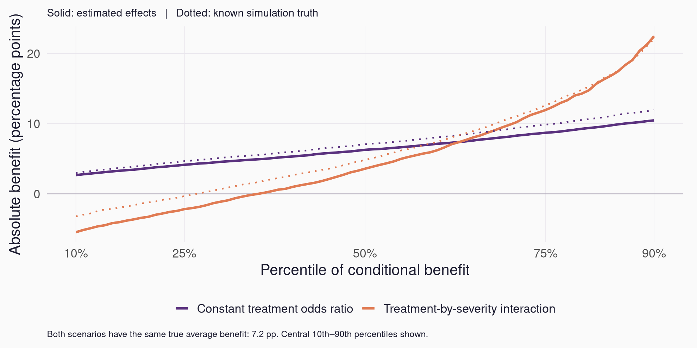
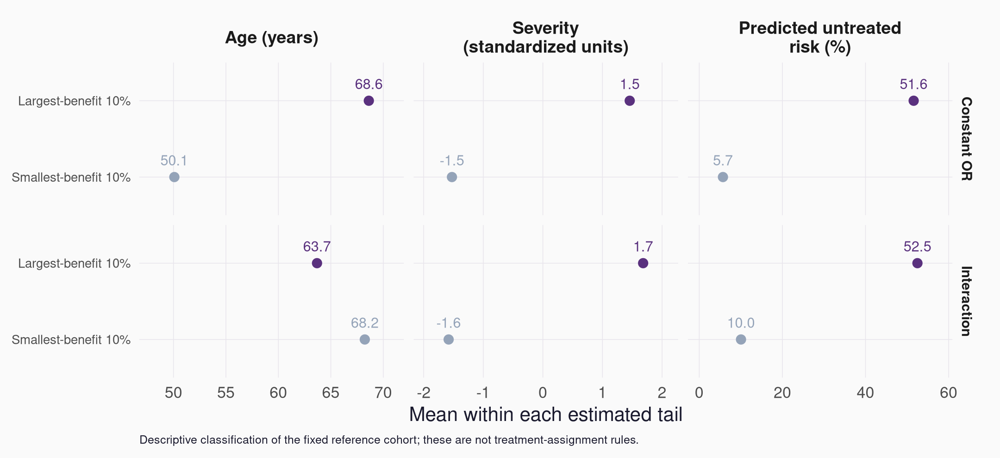
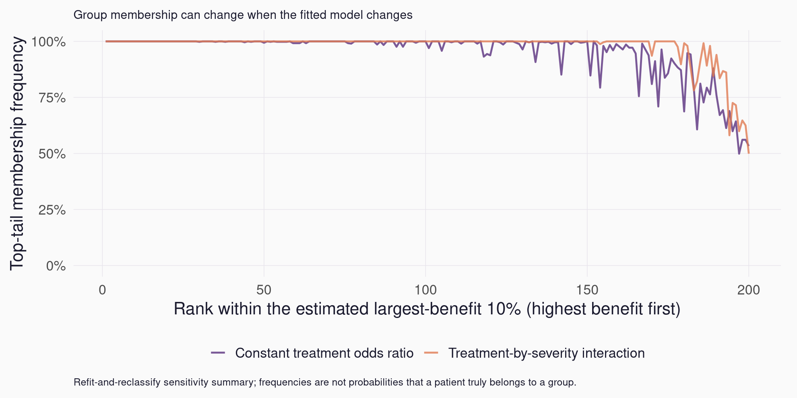
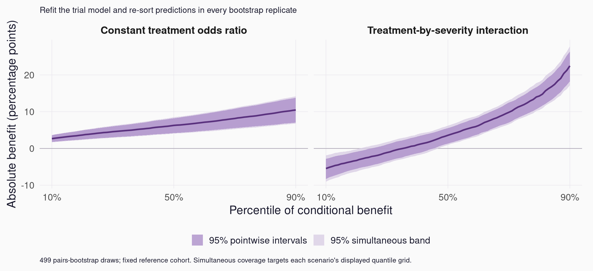

```{r}
#| label: session_data
#| include: false
required <- c("results/scenario-summary.csv", "results/patient-profiles.csv",
              "results/figures/mortgage-example.png")
if (!all(file.exists(required))) {
  stop("Generate the results first: Rscript R/demo.R; Rscript scripts/benchmark-sortedeffects.R")
}
scenarios <- read.csv("results/scenario-summary.csv")
constant <- scenarios[scenarios$scenario == "constant", , drop = FALSE]
interaction <- scenarios[scenarios$scenario == "interaction", , drop = FALSE]
pp <- function(x) sprintf("%.1f", 100 * x)
```

## Our route {#session-map .map-slide data-transition="fade"}

::: {.content-visible when-format="revealjs"}
::: {.session-map}
::: {.map-card}
[01 · Scale](#scale){.map-title}

Same treatment. Different absolute benefit.
:::
::: {.map-card}
[02 · Distribution](#distribution){.map-title}

See what the average conceals.
:::
::: {.map-card}
[03 · Patients](#patients){.map-title}

Reconnect the curve to patient profiles.
:::
::: {.map-card}
[04 · Uncertainty](#uncertainty){.map-title}

Find out how stable the picture is.
:::
::: {.map-card}
[05 · Evidence](#evidence){.map-title}

Read a published example with real data.
:::
::: {.map-card}
[06 · Decisions](#decisions){.map-title}

Ask what would change clinical practice.
:::
:::

::: {.key-hint}
**→** chapters · **↓** examples · **Space** follow the story · **Esc** see the whole deck
:::
:::

::: {.content-visible when-format="beamer"}
1. Choose the effect scale.
2. Explore the distribution and patient profiles.
3. Consider uncertainty and published evidence.
4. Discuss clinical decisions.
:::

::: notes
This is the session map. In HTML, the six cards jump to chapter opening slides. Horizontal navigation moves between chapters; vertical navigation explores the slides within each chapter. Space follows the entire sequence. Esc or O opens Reveal's two-dimensional overview. The prepared content still takes around 35–40 minutes, leaving time for discussion in the one-hour session. Use the map to return to a topic during questions.
:::

# Choose the scale {#scale .chapter-slide data-chapter-label="Scale" data-background-color="#261b37" data-background-transition="fade"}

::: {.chapter-number}
01
:::

::: {.chapter-lead}
A common odds ratio can hide very different absolute benefits.
:::

::: {.chapter-cue}
↓ Start with two patients
:::

## Same treatment. Same benefit? {#same-treatment data-auto-animate="true"}

Both patient profiles have a **treatment odds ratio of 0.60**.

::: columns
::: {.column width="48%" .patient-card .fragment .fade-up fragment-index="0" data-id="patient-low"}
### Lower baseline risk

10% → 6.25% event risk

Risk without → with treatment
:::
::: {.column width="48%" .patient-card .fragment .fade-up fragment-index="1" data-id="patient-high"}
### Higher baseline risk

40% → 28.57% event risk

Risk without → with treatment
:::
:::

::: {.prompt .fragment .fade-up fragment-index="2"}
Which description of the treatment effect would you report?
:::

::: notes
0–4 minutes. Open with a vote: homogeneous or heterogeneous treatment effect? Both answers need an effect scale. These numbers are algebraic illustrations, not estimates from the simulated trial. For OR theta and untreated risk p, treated risk is theta*p/(1-p+theta*p). All discussion concerns a hypothetical binary adverse outcome at a fixed follow-up time. A 3.75 percentage-point reduction means about four fewer events per 100 comparable patients on average; it is not a known outcome for a specific patient.
:::

## Different absolute benefits {#absolute-benefits data-auto-animate="true"}

The same odds ratio. **Different absolute risk reductions.**

::: columns
::: {.column width="48%" .patient-card data-id="patient-low"}
### Lower baseline risk

::: {.metric}
3.75 pp
:::

10% → 6.25% event risk
:::
::: {.column width="48%" .patient-card data-id="patient-high"}
### Higher baseline risk

::: {.metric}
11.43 pp
:::

40% → 28.57% event risk
:::
:::

::: {.prompt}
Heterogeneity depends on the effect scale we choose.
:::

::: notes
Continue the opening discussion. The cards keep their patient-profile identity as we change the displayed summary. The numbers are analytic illustrations under a known odds ratio of 0.60. The absolute risk reduction is a difference in probabilities, expressed in percentage points. Both scale descriptions are valid; neither establishes a biological mechanism. This is an extra visual step, not a new statistical analysis.
:::

## Define the benefit before sorting

For a patient profile $x$:

$$
\Delta(x)=\Pr(Y=1\mid A=0,X=x)-\Pr(Y=1\mid A=1,X=x)
$$

- A binary **adverse outcome** at a fixed follow-up time.
- Larger values mean greater **absolute risk reduction**.
- A conditional average contrast for comparable profiles.

::: {.small}
In our randomized-trial simulation, this identifies a conditional average causal benefit under the data-generating assumptions.
:::

::: notes
5–7 minutes. A is randomized treatment; X includes only baseline variables. Identification also presumes consistency and adequate treatment support; the simulation provides both. In observational data the same regression contrast needs conditional exchangeability and positivity to have a causal interpretation. Even in an RCT, we never observe both potential outcomes for one patient. The distribution of conditional average effects differs from the distribution of individual treatment effects. Explain sign here so the right tail always means greater benefit.
:::

## A constant odds ratio, varying absolute benefit {data-auto-animate="true"}

{width=95%}

::: {.source}
Simulation truth. The relationship can turn over at very high baseline risks; it is not globally increasing.
:::

::: notes
9–12 minutes. This figure shows the exact constant-OR relationship, with the opening profiles highlighted. Ask the audience what the x and y axes mean. The curve is curved because of the inverse-logit transformation. For a beneficial constant OR theta, absolute risk reduction is maximized at untreated risk 1/(1+sqrt(theta)); there is no universal monotonic risk-benefit rule. Within the observed low/moderate risk range the increasing section often dominates. We next compare this pattern with an interaction scenario. Both scenarios exhibit effect heterogeneity on the risk-difference scale.
:::

# Look beyond the average {#distribution .chapter-slide data-chapter-label="Distribution" data-background-color="#261b37" data-background-transition="fade"}

::: {.chapter-number}
02
:::

::: {.chapter-lead}
The same average benefit. Two very different distributions.
:::

::: {.chapter-cue}
↓ Build the sorted-effects curve
:::

## One trial. Two effect patterns. {data-auto-animate="true"}

::: columns
::: {.column width="48%"}
### Scenario A

Constant treatment odds ratio of **0.60**.

Absolute benefit varies with baseline risk.
:::
::: {.column width="48%"}
### Scenario B

Treatment interacts with baseline severity.

Absolute benefit also reflects the interaction pattern.
:::
:::

The **true average absolute benefit is matched by design** in the same reference population.

::: {.source}
Simulated randomized trial: 5,000 patients. Fixed reference population: 2,000 profiles. Logistic outcome models; no real patient data.
:::

::: notes
7–9 minutes. Both scenarios share the same untreated-risk model and baseline covariates. The treatment-interaction intercept is calibrated so true mean benefit matches scenario A in the fixed reference cohort; this is a teaching device, not estimation from observed outcomes. Trial covariates, treatment assignments and outcome-generating uniforms are shared to reduce irrelevant Monte Carlo variation; realized outcomes differ between scenarios. Their fitted average benefits need not match. The reference cohort is held fixed to make the estimand and bootstrap uncertainty explicit. Interaction coefficients depend on effect scale and do not establish biological mechanisms. Details and seeds are in the code and backup slides.
:::

## From a patient table to a sorted curve

| Profile | Risk without treatment | Risk with treatment | Benefit |
|:--|--:|--:|--:|
| A | 10% | 6.25% | 3.75 pp |
| B | 20% | 13.04% | 6.96 pp |
| C | 40% | 28.57% | 11.43 pp |

::: {.sorting-steps}
::: {.fragment .fade-up fragment-index="0"}
**01** Predict twice
:::
::: {.fragment .fade-up fragment-index="1"}
**02** Subtract
:::
::: {.fragment .fade-up fragment-index="2"}
**03** Sort the contrasts
:::
:::

::: {.small}
Here the contrast is a finite change in treatment, rather than a derivative. The same idea extends to other partial effects.
:::

::: notes
12–14 minutes. These are the same constant-OR algebraic illustrations as the opening. Each profile is predicted under both treatments. We sort the differences, not the treated outcome predictions, and not their standard errors. Once sorted, the horizontal axis records rank/percentile rather than a named patient characteristic. It is useful to physically trace the three rows left to right before showing the curve. Sorted effects is a summary layer on a chosen effect model; it does not discover a causal design or fit a model automatically.
:::

## Similar averages can hide different distributions

{width=95%}

::: {.source}
True mean benefit: `r pp(constant$mean_true_benefit)` pp in both scenarios. Negative benefit means increased adverse-event risk. Central 10th–90th percentiles shown.
:::

::: notes
14–17 minutes. Orient the audience to solid estimated curves and dotted simulation truth. True averages were matched by design at 7.21 pp; fitted averages are about 6.37 pp and 6.03 pp. The interaction scenario deliberately includes profiles with conditional average harm, which appear below zero. This is known in the simulation; a negative fitted contrast alone would need uncertainty assessment in real data. An APE is the mean of all profile-level benefits; it is not generally the median of this curve. The plotted quantiles deliberately omit the most extreme tails. This plot demonstrates distributional differences between the two scenario models, not a formal hypothesis test comparing curves. Point estimates alone do not establish statistically significant heterogeneity. Ask which part of the curve would matter for a clinical decision and why.
:::

## What does a point on the curve mean?

The **80th percentile** is the benefit level at or below which approximately 80% of reference profiles lie.

It is a **quantile of conditional benefits**.

It is different from:

- the treatment effect on the 80th percentile of the outcome;
- a probability that a particular patient will benefit.

::: notes
17–19 minutes. This is a quantile of the distribution of model-based conditional contrasts, not a quantile treatment effect. For a binary endpoint, the contrast is in probabilities. Quantile language can sound patient-specific, so return to the fact that these are averages among comparable profiles. At a population distribution with ties, percentile wording needs the usual quantile convention. The simulation uses empirical type-8 quantiles. The reference population also matters: changing the mix of patients can change the curve with exactly the same fitted conditional model.
:::

# Meet the patient profiles {#patients .chapter-slide data-chapter-label="Patients" data-background-color="#261b37" data-background-transition="fade"}

::: {.chapter-number}
03
:::

::: {.chapter-lead}
The curve shows how much. Classification asks who.
:::

::: {.chapter-cue}
↓ Explore the tails
:::

## Who occupies the tails?

{width=95%}

::: {.source}
Descriptive profiles of the lowest and highest 10% of estimated benefits in both scenarios. These summaries have no classification confidence intervals.
:::

::: notes
19–22 minutes. The sorted curve answers how much variation there is. Classification analysis asks what the profiles in selected tails look like. Explain that grouping is by estimated benefit, not by the outcome. The characteristics are correlated and may be ingredients of the fitted model: this is not independent evidence that age or severity causally modifies response. The formal SortedEffects method supplies inference for classification parameters; this clinical-demo table is descriptive only. In the original-package reproduction we separately exercise its ca() procedure. Choice of a 10% tail is prespecified for the illustration, not optimized to produce a dramatic contrast.
:::

## A tail label can be unstable

{width=95%}

::: {.source}
Bootstrap reclassification in the fixed reference population. Membership frequencies measure sensitivity to refitting; they are not patient-level probabilities of benefit.
:::

::: notes
22–24 minutes. Every bootstrap fit re-predicts all reference profiles and reassigns the top-benefit tail. Profiles near the estimated cutoff can change sides. Ask what a clinical team would do with a patient near this boundary. These bootstrap frequencies are diagnostics, not calibrated confidence probabilities that a patient is truly in a tail. They also inherit the chosen regression model and its assumptions; stability under refitting does not prove validity under model misspecification. A discrete tail boundary should not masquerade as a biological subtype.
:::

# How stable is the picture? {#uncertainty .chapter-slide data-chapter-label="Uncertainty" data-background-color="#261b37" data-background-transition="fade"}

::: {.chapter-number}
04
:::

::: {.chapter-lead}
A persuasive ranking still needs an uncertainty statement.
:::

::: {.chapter-cue}
↓ Refit, re-sort, reconsider
:::

## Add uncertainty to the sorted curve

{width=95%}

::: {.source}
Approximate 95% intervals from refitting and re-sorting. Simultaneous coverage concerns the displayed percentile grid, conditional on the reference population and model.
:::

::: notes
24–27 minutes. Identify pointwise versus simultaneous intervals using the legend. Pointwise intervals concern one percentile at a time; the simultaneous band concerns the whole selected grid. The demo resamples randomized-trial rows, refits the model, predicts both treatments for the same reference profiles, and sorts again. Its max-standardized-deviation critical value is estimated from the same bootstrap draws. This is a transparent illustration of the inferential ingredients, not a benchmarked reimplementation of the Econometrica inference procedure. There are 499 draws by default; this is a teaching calculation rather than a high-precision production analysis. The band is not an interval for an individual patient's effect. A sloping fitted curve alone is no proof of heterogeneity.
:::

## What uncertainty have we included?

**Included:** estimation of the outcome model, prediction of contrasts, and re-sorting after each refit.

**Held fixed:** the reference patient profiles and the chosen model specification.

**Requires further work:** model sensitivity, new-population uncertainty, and formal inference for the clinical tail comparisons.

::: {.prompt}
Would your main concern be sampling uncertainty or the model itself?
:::

::: notes
27–29 minutes. If the reference profiles are a sample from a larger target population, holding them fixed does not quantify sampling variation in that population's covariate distribution. Resampling designs must match the target: fixed reference, a joint trial population, external weighted population, clusters, etc. Smoothness and nondegeneracy matter near ties and flat effect distributions; ordinary bootstrap quantile arguments can fail. Do not present a universal recipe for every effect estimator. This is a natural pause for a statistician audience to ask about model checking and resampling design without deriving the theorem.
:::

# Read the evidence {#evidence .chapter-slide data-chapter-label="Evidence" data-background-color="#261b37" data-background-transition="fade"}

::: {.chapter-number}
05
:::

::: {.chapter-lead}
What does the method reveal in a published application?
:::

::: {.chapter-cue}
↓ A real-data example
:::

## A published example with real data

**Mortgage denials in Boston, 1990** [@chen2020; @munnell1996].

- 2,380 applicants: 2,041 white and 339 Black applicants.
- Logistic model with financial and demographic controls.
- Contrast: predicted denial risk for Black versus white applicants at the same modeled covariates.

The tutorial reports an average adjusted denial disparity of **5.1 pp**, with a **90% interval of 2.1–8.1 pp**.

::: {.source}
Published, bias-corrected result from Chen et al. (2020), Table 1; 500 bootstrap repetitions. This is a separate analysis from our clinical simulation.
:::

::: notes
29–31 minutes. We use a fully verified published tutorial rather than an unverified clinical-paper summary. The data are observational. Treat the race contrast as an adjusted disparity; causal interpretations of race indicators require a carefully defined question and assumptions beyond logistic regression. The published result is displayed as published, not represented as our own reproduction. The software exercise uses the same public dataset and specification with a new bootstrap run; finite-repetition inference can differ. The direction here is Black minus white denial risk, so positive means a larger adverse disparity; the clinical example's benefit sign is different. Emphasize the legend on the next slide.
:::

## From an average disparity to its distribution

{width=95%}

::: {.source}
New reproduction using the original SortedEffects 1.7.0 package. Positive values mean higher predicted denial risk for Black applicants. See validation notes for repetitions and comparisons.
:::

::: notes
31–33 minutes. Point to the mean reference and the shape of the sorted-effects curve. The original tutorial also compares the characteristics of the highest and lowest 10% of disparities using its classification-analysis inference. Ask what the curve adds to the average and what it cannot resolve about discrimination, selection, or omitted variables. The contrast is not a patient-treatment benefit and should not be clinically reinterpreted. Our package benchmark checks exact point-estimate agreement with a direct glm calculation and exercises original bootstrap and classification procedures; it does not independently prove the statistical coverage theorem.
:::

# From patterns to decisions {#decisions .chapter-slide data-chapter-label="Decisions" data-background-color="#261b37" data-background-transition="fade"}

::: {.chapter-number}
06
:::

::: {.chapter-lead}
What additional evidence would justify changing treatment?
:::

::: {.chapter-cue}
↓ Open the discussion
:::

## What would we do in a clinical study?

1. Specify the **outcome, time horizon, effect scale and population**.
2. Justify the **causal design** and fit a credible effect model.
3. Show the **average, sorted distribution and tail descriptions**.
4. Assess **uncertainty, model sensitivity and external validity**.

::: {.small}
The sorted-effects method summarizes the effects supplied to it. Its interpretation inherits their assumptions.
:::

::: notes
33–35 minutes. For an RCT, identify prespecified effect modifiers and ensure adequate sample size for interactions. For an observational study, address confounding and support before sorting anything. Use only pretreatment covariates when defining baseline benefit. Calibration for outcome prediction is relevant but does not alone establish accurate treatment-effect heterogeneity. Prespecify the reference population, percentile range, and tail sizes. For clinical claims, assess robustness across plausible models and in new data; a single fitted logistic model is an illustration, not a validated decision aid.
:::

## Would you use this to choose treatment?

::: {.large}
A patient profile lies in the highest-benefit 10%.
:::

Before making a rule, consider:

- the **size** of benefit relative to harms and burden;
- uncertainty in the contrast and the **tail label**;
- whether the model transports to this setting;
- how the proposed rule performs in **independent evaluation**.

::: notes
35–37 minutes, or pause longer. Ask the group to articulate a concrete decision threshold. Ranking patients is not the same as selecting an optimal policy. If all patients have benefit larger than harms, restricting treatment to the top decile can be worse than treating all. If harms vary, sorting benefit alone can give the wrong ranking. A policy evaluation needs an explicit utility function, constraints, and validation. Conditional average benefits are useful inputs to shared decisions, but patient preferences and individual realized outcomes are different quantities.
:::

## Three things to take away {.takeaways-slide}

::: {.large}
::: {.fragment .fade-up fragment-index="0"}
**Choose the scale.**
:::

::: {.fragment .fade-up fragment-index="1"}
**Show the distribution.**
:::

::: {.fragment .fade-up fragment-index="2"}
**Interrogate the tails.**
:::
:::

An appealing ranking still needs a credible model, appropriate inference, and clinical validation.

::: notes
37–38 minutes. Briefly revisit opening example: a fixed OR already creates heterogeneity on the absolute scale. The sorted-effects curve gives a distributional summary rather than only a mean. Classification is a useful description, with uncertainty and interpretation that need care. No new technical concepts here. If the session is running long, move directly from this slide to discussion.
:::

## Open discussion

1. Where would this add something to our current subgroup analyses?
2. Which assumptions or diagnostics would you want to challenge first?
3. What evidence would justify changing a treatment decision?

::: {.source}
Keep the earlier plots available for discussion. Technical details and software checks follow in the backup slides.
:::

::: notes
38–60 minutes, adjusted for earlier discussion. Useful follow-ups: why sort rather than model a few prespecified interactions? How does this differ from CATE estimation with forests? What if the distribution is nearly flat? What if the tails have weak support? Would a different reference population change our takeaway? Would risk stratification already suffice? Avoid promising that sorting solves confounding, model selection, or individual treatment-effect identification.
:::

## Reading and resources

**Method:** [@chernozhukov2018].

**Applied tutorial and original software:** [@chen2020].

The session page contains the slides, code, numerical results and source notes.

::: {.prompt}
Thank you — which clinical example should we try next?
:::

::: notes
End of main material. The clinical application leads in the brainstorming notes are recorded in docs/evidence.md with their verification status. They have not been used as evidence for specific health claims in this deck. Original package status and local validation details are in docs/software-validation.md. The following slides are optional backup and do not need to be presented in the prepared 35–40 minutes.
:::

# A closer look {#backup .chapter-slide .backup-chapter data-chapter-label="Backup" data-background-color="#261b37" data-background-transition="fade"}

::: {.chapter-number}
\+
:::

::: {.chapter-lead}
Optional details on the estimand, simulation and original software.
:::

::: {.chapter-cue}
↓ Technical backup
:::

## Backup · What is being sorted?

$$
\mathrm{SPE}(u)=Q_{\Delta(X)}(u), \qquad
\mathrm{APE}=E[\Delta(X)].
$$

- The distribution of $X$ defines the population being summarized.
- Sorting discards the profile labels; classification reconnects them.
- A quantile of effects differs from a difference of outcome quantiles.

::: {.source}
[@chernozhukov2018]. Demo: empirical reference distribution; type-8 quantiles.
:::

::: notes
The original paper provides inference for sorted effects and classification under its regularity conditions. Its framework extends beyond the simple binary treatment contrast in this presentation. The demo intentionally conditions on a finite reference cohort and uses a percentile grid from 0.10 to 0.90. APE is the mean of profile contrasts, not the area under a truncated curve. Formal population inference must account for estimated effect functions and, where applicable, the covariate distribution. Under a constant effect the distribution degenerates and ordinary regular quantile arguments need extra care.
:::

## Backup · Simulation and fitting

Common untreated-risk model: baseline age, severity and sex.

**A:** treatment enters the logit with coefficient $\log(0.60)$.

**B:** treatment interacts with baseline severity; its intercept is calibrated to match A's true mean benefit.

Both fitted models use the corresponding correct specification.

::: {.source}
R/demo.R contains the exact coefficients, random seeds, calibration, sample sizes and diagnostics.
:::

::: notes
This is deliberately favorable to regression: the fitted specification matches the data-generating model. That makes it possible to demonstrate known truth, sampling variability and sorting separately. It does not show robustness under misspecification or compare methods for learning unknown effect heterogeneity. The reference cohort is independent of the trial and fixed across bootstrap fits. Covariate scales and interaction coefficients are implementation details in the code; inspect them with interested participants rather than adding a technical derivation to the main narrative.
:::

## Backup · Bootstrap ingredients

For each resample of the randomized trial:

1. Refit the outcome regression.
2. Predict both treatments for the **same** reference profiles.
3. Recalculate benefits and re-sort at each percentile.
4. Recalculate tail membership and descriptive summaries.

The simultaneous band uses the maximum standardized deviation over the displayed percentile grid.

::: notes
The demo reports pointwise bootstrap intervals and an approximate max-t band. It fixes the original reference distribution, rather than resampling reference profiles. Rows are independent here; a cluster trial would require a different resampling unit. Bootstrap validity depends on the estimand and regularity, including density/nondegeneracy around quantiles, not merely on repeating these computational steps. Membership frequencies and descriptive tail summaries are not formal classification confidence statements. A practical production analysis would use more repetitions and assess Monte Carlo precision. See the original paper for its inferential procedure; do not substitute this teaching bootstrap for it without validation.
:::

## Backup · Original software as a benchmark

- The original **SortedEffects 1.7.0** release is preserved in a pinned CRAN GitHub mirror.
- Reproduce its mortgage example using `spe()` and `ca()`.
- Compare point estimates with direct `glm()` predictions.
- Record bootstrap results, plotting behavior and limitations separately.

::: {.source}
scripts/benchmark-sortedeffects.R and docs/software-validation.md. The clinical simulation and its inference target are separate from this benchmark.
:::

::: notes
An archived package status is a maintenance signal, not evidence that every statistical procedure is wrong. Equally, an example running is not proof of correct inference. We check numerical agreement for point and classification estimates and run the original bootstrap code; coverage claims still rely on the published assumptions and theory. The native plotting method succeeds on this runtime. Our slide figure is drawn from the returned estimates, and no estimator source was changed. The exact source commit, source checksum, installed dependencies and observed results are in the validation notes.
:::

## References {.smaller}

::: {#refs}
:::
