```{r}
#| label: session_data
#| include: false
spe_data <- read.csv("results/colon/interaction-spe.csv")
ape <- read.csv("results/colon/interaction-ape.csv")
classification <- read.csv("results/colon/classification-stabilized.csv")
pp <- function(x) sprintf("%.1f", 100 * x)
warmup <- read.csv("results/warmup/population-risks.csv")
warmup_means <- read.csv("results/warmup/population-means.csv")
stopifnot(all(abs(warmup_means$mean_benefit - .10) < 1e-12))
patients <- read.csv("results/colon/patient-benefits.csv")
stopifnot(nrow(patients) == 593L, abs(mean(patients$benefit) - ape$estimate) < 1e-10)
near_average <- sprintf("%.0f%%", 100 * mean(abs(patients$benefit - ape$estimate) <= .03))
# HTML entities keep R output ASCII under any locale; pandoc turns them into characters.
minus <- function(x) gsub("-", "&minus;", x, fixed = TRUE)
constant_spe <- read.csv("results/colon/constant-spe.csv")
at10 <- function(d) d[abs(d$percentile - .10) < 1e-9, ]
critical <- function(d) with(at10(d), (upper_uniform - estimate) / standard_error)
band10 <- with(at10(spe_data), c(lower_uniform, upper_uniform))
pointwise10 <- with(at10(spe_data), estimate + c(-1, 1) * qnorm(.975) * standard_error)
stopifnot(abs(critical(spe_data) - with(at10(spe_data), (estimate - lower_uniform) / standard_error)) < 1e-8)
interval <- function(x) minus(sprintf("%+.1f to %+.1f", 100 * x[1], 100 * x[2]))
ca_table <- function(variables) {
  d <- classification[match(variables, classification$variable), ]
  labels <- c(age = "Age (years)", female = "Female (%)",
    old_men = "Men aged 65+ (%)", younger_women = "Women under 55 (%)",
    nodes = "Positive nodes", nodes_over4 = "More than 4 nodes (%)",
    poor_diff = "Poor differentiation (%)", extensive = "Serosa or beyond (%)",
    obstruct = "Bowel obstruction (%)", perfor = "Perforation (%)",
    adhere = "Tumour adherence (%)", surg_late = "Long surgery interval (%)")
  knitr::kable(data.frame(
    Characteristic = unname(labels[d$variable]),
    Low = sprintf("%.1f", d$low_mean * d$multiplier),
    High = sprintf("%.1f", d$high_mean * d$multiplier),
    Difference = sprintf("%+.1f", d$difference * d$multiplier),
    SE = sprintf("%.1f", d$standard_error * d$multiplier),
    `Joint p` = sprintf("%.3f", d$joint_p), check.names = FALSE),
    align = c("l", rep("r", 5)))
}
```

## Session overview {#session-map .map-slide data-transition="fade"}

::: {.content-visible when-format="revealjs"}
::: {.session-map}
::: {.map-card}
[01 · The question](#question){.map-title}

Is the effect the same for everybody? Today's papers.
:::
::: {.map-card}
[02 · Sorted effects](#steps){.map-title}

Four steps on a colon cancer trial, with the R code.
:::
::: {.map-card}
[03 · Trust](#trust){.map-title}

Uniform bands, model choice and new patients.
:::
::: {.map-card}
[04 · Discussion](#discussion){.map-title}

Three trials side by side. What would convince us?
:::
:::
::: {.key-hint}
**→** chapters · **↓** slides within a chapter · **Space** next step · **Esc** overview
:::
:::

::: {.content-visible when-format="beamer"}
1. Is the effect the same for everybody? Today's papers.
2. Sorted effects, step by step, with the R code: a colon cancer trial.
3. Can we trust the pattern? Uniform bands, model choice and new patients.
4. Three trials side by side, and discussion.
:::

::: notes
About 40 minutes, then open discussion: Question 8 · Sorted effects 15 · Trust 9 · Three trials and discussion opener 8. If time runs short, skip the symbols slide and the tumour-characteristics profile, show only the first and last step of each code call, and give the band slide one sentence. The framing follows Huntington-Klein, The Effect, section 22.3. The model code, why the package's tail bootstrap failed, and full tables are in the backup stack.
:::

# Is the effect the same for everybody? {#question .chapter-slide data-chapter-label="Question"}

::: {.chapter-number}
01
:::
::: {.chapter-lead}
A trial reports one average effect. Whom does it describe?
:::
::: {.chapter-cue}
↓ Why one number can hide many stories
:::

## One average, many patients {#one-average}

- A trial answers: does the treatment work **on average**?
- Patients differ, so the effect can differ too: large for some, small or none for others.
- So we also want to know: **who benefits most, and who least?**

::: {.prompt}
"Why not … just estimate the distribution of effects?" *The Effect*, §22.3 [@huntingtonklein2025]
:::

::: notes
The Effect: causal inference would be much easier if each effect were the same for everybody, but we live in a world of heterogeneous effects. Instead of treating heterogeneity as a nuisance, estimate the distribution of effects and look at who is affected most and least. Sorted effects [@chernozhukov2018] does this from a model that already allows the effect to differ.
:::

## Today's papers {#papers}

::: {.paper-cards}
::: {.fragment .fade-up}
[**Method · Econometrica 2018**]{.paper-kicker}

*The sorted effects method: discovering heterogeneous effects beyond their averages*

@chernozhukov2018

- Sorted partial effects: the percentiles of the effect
- Classification analysis: who is most and least affected
- Bootstrap bands for the whole curve
:::
::: {.fragment .fade-up}
[**Software · The R Journal 2020**]{.paper-kicker}

*SortedEffects: sorted causal effects in R*

@chen2020

- `spe()`: sorted effects with uniform bands
- `ca()`: compare the most and least affected
- Worked example: mortgage denials (backup)
:::
::: {.fragment .fade-up}
[**Intuition · The Effect 2025, §22.3**]{.paper-kicker}

*The Effect: an introduction to research design and causality*

@huntingtonklein2025

- Model the effect, predict it for everyone, sort, describe
- Free online textbook
- Also causal forests: next time
:::
:::

::: {.source}
Our worked example: a public colon cancer trial [@moertel1990]. Full references at the end.
:::

::: notes
The Econometrica paper's subtitle is "discovering heterogeneous effects beyond their averages". It defines the sorted partial effect, the classification analysis of the most and least affected, and bootstrap inference that holds over a whole range of percentiles. The R Journal paper documents the package we use, including the mortgage-denial example (backup).
:::

## Same average, different stories {#warmup-average}

Three equally common kinds of patients, A, B and C. Without treatment, 40% of each die.

::: {.fragment .fade-up}
```{r}
#| label: warmup_effect_table
#| results: asis
profiles <- c("A", "B", "C")
story <- c("Constant benefit" = "Everyone benefits equally",
           "Heterogeneous benefit" = "Benefit differs")
warmup_table <- do.call(rbind, lapply(warmup_means$scenario, function(name) {
  d <- warmup[warmup$scenario == name, ]
  values <- sprintf("%+.0f", 100 * d$benefit[match(profiles, d$profile)])
  data.frame(Scenario = unname(story[name]), A = values[1], B = values[2], C = values[3])
}))
knitr::kable(warmup_table, col.names = c("Benefit (pp)", "A", "B", "C"),
             align = c("l", "r", "r", "r"), row.names = FALSE)
```

Both stories: average benefit **10 pp**. The average cannot tell them apart.
:::

::: {.source}
Constructed example with known risks, not data. Benefit = risk without treatment − risk with treatment.
:::

::: notes
Treated risks are 30/30/30% or 50/30/10%, so both populations have 30% marginal treated risk. Negative benefit means higher risk under treatment. These are specified population quantities: no estimation or confidence interval is involved.
:::

## Sorting tells them apart {#warmup-distribution .figure-slide}

::: columns
::: {.column width="70%"}
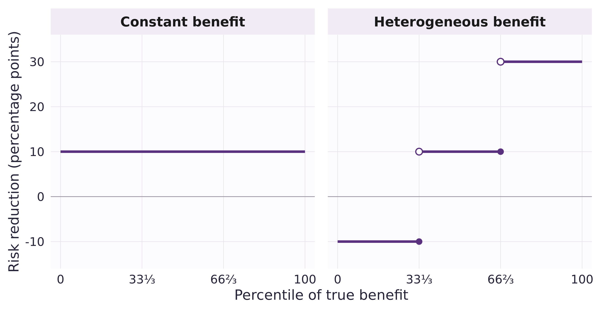{.panel-figure width=100%}
:::
::: {.column width="30%" .figure-notes}
- Line patients up from least to most benefit.
- Everyone benefits equally: a flat line at **10 pp**.
- Benefit differs: a staircase from **−10 to +30 pp**.
- One third are worse off, despite a positive average.
:::
:::

::: {.prompt}
In a trial we must estimate this curve. That is what sorted effects do.
:::

::: {.source}
Exact quantiles of the constructed example; no estimation.
:::

::: notes
The quantile function uses the inverse-CDF convention: at a jump, the filled point belongs to the lower step. The discrete example shows what sorting summarizes, not the regularity conditions or coverage of the inferential method.
:::

## Even a constant odds ratio gives different benefits {#effect-scale .figure-slide}

::: columns
::: {.column width="70%"}
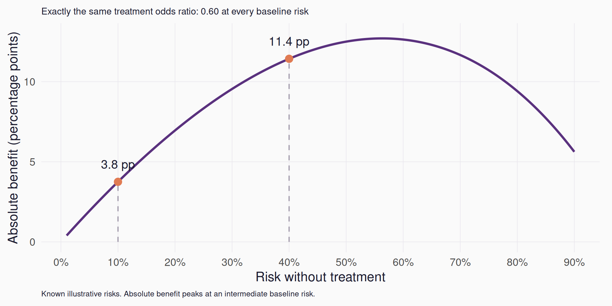{.panel-figure width=100%}
:::
::: {.column width="30%" .figure-notes}
- Same odds ratio (**0.60**) for every patient.
- **10%** baseline risk → **3.8 pp**.
- **40%** baseline risk → **11.4 pp**.
- A logistic model already lets benefits differ; interactions let them differ more.
:::
:::

::: {.source}
Algebraic illustration with known risks.
:::

::: notes
For odds ratio theta and control risk p, treated risk is theta*p/(1-p+theta*p). Absolute benefit is not globally monotone in baseline risk. The Effect makes the same point: logit and probit models naturally produce heterogeneous effects on the probability scale. Benefit throughout is on the absolute scale: risk without minus risk with treatment.
:::

# Sorted effects, step by step {#steps .chapter-slide data-chapter-label="Sorted effects"}

::: {.chapter-number}
02
:::
::: {.chapter-lead}
A colon cancer trial: who benefits from chemotherapy?
:::
::: {.chapter-cue}
↓ Model, predict, sort, describe
:::

## The trial {#trial-data}

- 619 patients with resected **stage III colon cancer**, randomized to observation or **levamisole + 5-FU**.
- Outcome: **death within three years**.
- Died: **34.7%** with observation (109/314), **25.7%** with chemotherapy (78/304).
- On average, about **9 fewer deaths per 100** treated patients. The same for everybody?

::: {.source}
`survival::colon`, from the trial reports [@moertel1990; @moertel1995]. The third arm, levamisole alone, is not used. Analyses use the 593 patients with complete baseline data.
:::

::: notes
Death records only. One participant was censored before three years; 25 further participants lacked node count or differentiation. Complete-case estimates target the retained cohort rather than the full randomized population. The crude difference is 9.1 pp; assigning the unknown outcome either way gives 8.95–9.26 pp, not a confidence interval. The model-standardized average over the 593 patients is 8.1 pp (95% CI 1.4 to 14.9).

The final report covers 929 eligible stage III (Dukes' C) patients: levamisole plus fluorouracil reduced the recurrence rate by 40% and the death rate by 33% (median follow-up 6.5 years). Levamisole alone had little effect.
:::

## Step 1 · Let the effect differ {#step-model}

- A logistic model for death within three years.
- Chemotherapy's effect may change with **age, sex, number of positive nodes, tumour grade and tumour extent**.
- Bowel obstruction, tumour adherence to nearby organs and time from surgery to registration adjust the baseline risk.

::: {.prompt}
Randomization makes the comparison fair; the model only describes how the effect varies.
:::

::: {.source}
Six treatment interactions, fixed before fitting; 19 parameters. Model code in backup.
:::

::: notes
Age enters the baseline risk as a three-degree-of-freedom spline and the interactions linearly, with an age-by-sex term. The Effect: a model with many interactions is hard to read coefficient by coefficient; sorted effects summarizes it in one dimension, the effect itself. Sorting does not identify the effect: that comes from the randomized design.
:::

## Step 2 · Predict both futures for every patient {#step-predict .figure-slide}

::: columns
::: {.column width="70%"}
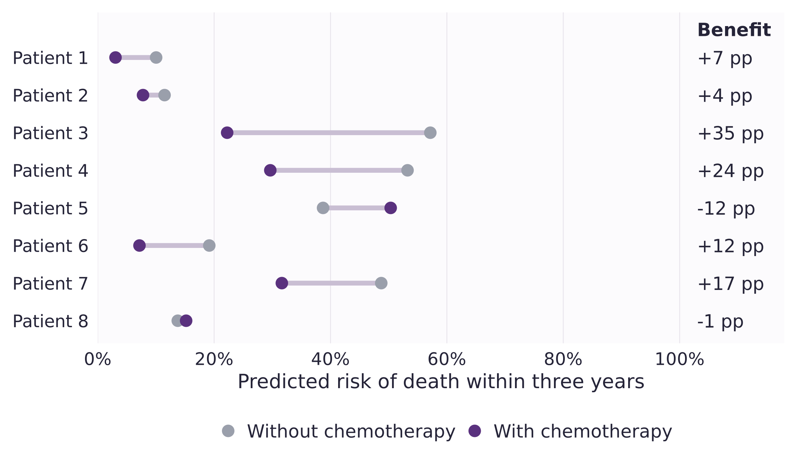{.panel-figure width=100%}
:::
::: {.column width="30%" .figure-notes}
- For each patient: predicted risk **without** and **with** chemotherapy.
- The gap is the **estimated benefit**.
- It is an average for patients like them, not a personal effect.
:::
:::

::: {.source}
Eight of 593 patients, chosen to span the range and shown unsorted. Point estimates from the Step 1 model.
:::

::: notes
Each prediction keeps the patient's baseline characteristics and changes only treatment. Under randomization the gap estimates the conditional average effect for that covariate profile, E[Y(0) − Y(1) | X = x]. It does not reveal what would happen to this particular patient.
:::

## Step 3 · Sort them {#step-sort .figure-slide}

::: columns
::: {.column width="70%"}
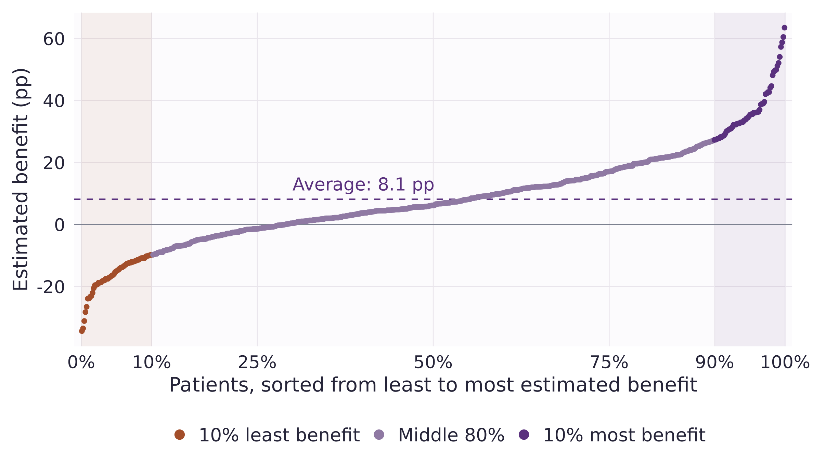{.panel-figure width=100%}
:::
::: {.column width="30%" .figure-notes}
- All 593 patients, from least to most estimated benefit.
- Average: **`r pp(ape$estimate)` pp**. Middle 80%: **−10 to +27 pp**.
- Only **`r near_average`** of patients are within 3 pp of the average.
- The extremes are the least certain estimates.
:::
:::

::: {.source}
Point estimates; uncertainty follows in chapter 03.
:::

::: notes
The 10th and 90th percentiles are −9.8 and 27.3 pp. Percentiles of the sorted benefits are the sorted partial effects; the band in chapter 03 covers the 10th to 90th percentiles, where estimation is more stable than at the extremes.
:::

## In symbols: three estimands {#estimand}

$$
\Delta(x)=\Pr(Y=1\mid A=0,X=x)-\Pr(Y=1\mid A=1,X=x)
$$

$$
\mathrm{APE}=E[\Delta(X)], \qquad \mathrm{SPE}(u)=Q_{\Delta(X)}(u), \quad u\in[0.1,\,0.9]
$$

$$
\mathrm{CA}(Z)=E[Z\mid \Delta(X)\ge \mathrm{SPE}(0.9)]-E[Z\mid \Delta(X)\le \mathrm{SPE}(0.1)]
$$

- $Y$: death within three years; $A$: chemotherapy (1) or observation (0); $X$: the eight traits in the model.
- Estimates plug the fitted model into $\Delta$ for all 593 patients; CA compares a trait $Z$ between the two 10% tails.
- With randomization, $\Delta(x)=E[Y(0)-Y(1)\mid X=x]$: an average for profile $x$, not an individual effect.

::: {.source}
Notation after @chernozhukov2018. SPE is a quantile of effects, not a difference between outcome quantiles.
:::

::: notes
APE is the average partial effect, SPE the sorted partial effect, CA the classification analysis. The distribution of X, here the 593 observed profiles, defines the population summarized; changing it can change both APE and SPE. Randomization supports identification; sorting does not replace it.
:::

## Step 3 in R: spe() {#spe-call .code-slide .code-focus}

::: columns
::: {.column width="68%"}
```{.r code-line-numbers="2-3|4-5|6|7-9"}
spe_result <- SortedEffects::spe(
  fm = fm, data = dat,
  method = "logit",
  var_type = "categorical", var = "treatment",
  compare = c("chemotherapy", "observation"),
  us = seq(.10, .90, .01),
  b = 499,
  alpha = .05, bc = FALSE,
  seed = 420
)
```
:::
::: {.column width="32%" .code-explanations}
::: {.code-callout data-code-lines="2-3"}
**Fit the outcome model**

Our chosen formula and a logistic link.
:::
::: {.code-callout data-code-lines="4-5"}
**Set the contrast**

This ordering gives observation − chemotherapy.
:::
::: {.code-callout data-code-lines="6"}
**Choose the percentiles**

10th–90th, in one-percentile steps.
:::
::: {.code-callout data-code-lines="7-9"}
**Quantify uncertainty**

499 resamples; 95% band; no bias correction.
:::
:::
:::

::: {.source}
`fm` is the Step 1 model (code in backup). The band covers the chosen percentile grid; coverage needs valid effect estimates and regularity conditions.
:::

::: notes
spe() refits from the formula. The compare order yields the second prediction minus the first. In the full-sample path, refitting uses bootstrap weights while effect quantiles retain the original profile weights.
:::

## Step 4 · Who is at each end? {#step-describe .figure-slide}

::: columns
::: {.column width="70%"}
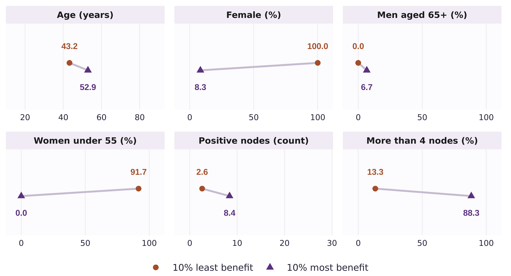{.panel-figure width=100%}
:::
::: {.column width="30%" .figure-notes}
- Least benefit: **all women**, mean age **43**.
- Most benefit: **92% men**, mean age **53**.
- More than four positive nodes: **13% vs 88%**.
:::
:::

::: {.source}
The 60 patients (10%) at each end. Points are tail means; the lines are not confidence intervals.
:::

::: notes
In R this is SortedEffects::ca(), classification analysis; the call follows the tumour profiles. Only 4 of the 60 high-tail patients are men aged at least 65. The demographic rows overlap (women under 55 are a subset of women) and are not independent findings. Tail membership depends jointly on age, sex and tumour characteristics, and was learned from this sample's outcomes.
:::

## Step 4 · Tumour characteristics {#step-describe-clinical .figure-slide}

::: columns
::: {.column width="70%"}
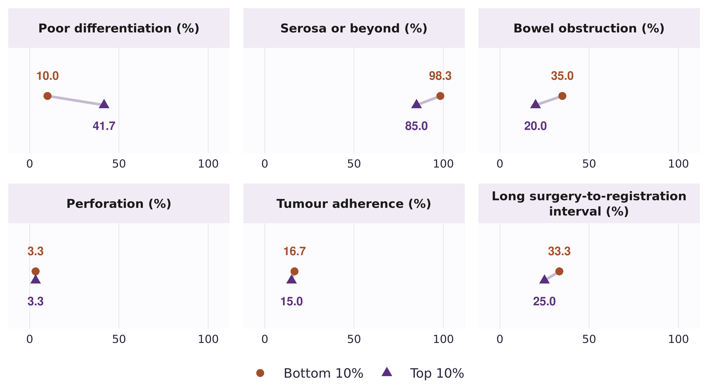{.panel-figure width=100%}
:::
::: {.column width="30%" .figure-notes}
- Poor differentiation: **10% vs 42%**.
- Bowel obstruction: **35% vs 20%**.
- Perforation: **3%** in both tails.
:::
:::

::: {.source}
Same 60 + 60 patients. “Adherence”: tumour adherence to nearby organs.
:::

## Step 4 in R: ca() {#ca-call .code-slide .code-focus}

::: columns
::: {.column width="68%"}
```{.r code-line-numbers="2-5|6|7-8|9-10"}
ca_result <- SortedEffects::ca(
  fm = fm, data = dat,
  method = "logit",
  var_type = "categorical", var = "treatment",
  compare = c("chemotherapy", "observation"),
  u = .10,
  interest = "moment", cl = "diff",
  t = colon_characteristics()$variable,
  b = 499, alpha = .05,
  bc = FALSE, seed = 420
)
```
:::
::: {.column width="32%" .code-explanations}
::: {.code-callout data-code-lines="2-5"}
**Model and contrast**

Same mortality model; benefit = observation − chemotherapy.
:::
::: {.code-callout data-code-lines="6"}
**Choose the tails**

Bottom and top 10%: 60 patients each here.
:::
::: {.code-callout data-code-lines="7-8"}
**Compare characteristics**

High − low means, across all twelve traits.
:::
::: {.code-callout data-code-lines="9-10"}
**Bootstrap inference**

499 resamples; SEs and p-values adjusted across the twelve traits.
:::
:::
:::

::: {.source}
`ca()` is classification analysis. For these data the package's own bootstrap broke down; the p-values on the next slide come from our checked re-run with stable starting values (backup).
:::

::: notes
The tails can contain patients from either randomized arm. cl = "diff" compares high-minus-low characteristic means; binary means are proportions. The moment interface returns SEs and joint p-values, not moment confidence intervals.
:::

## Step 4 · Which differences are beyond chance? {#step-describe-test}

```{r}
#| label: tail_table
#| results: asis
rows <- c(female = "Women", younger_women = "Women under 55", age = "Mean age (years)",
          nodes = "Mean positive nodes", nodes_over4 = "More than 4 positive nodes",
          poor_diff = "Poor differentiation")
d <- classification[match(names(rows), classification$variable), ]
digits <- ifelse(d$variable == "nodes", 1, 0)
level <- function(x) ifelse(d$multiplier == 100, sprintf("%.0f%%", 100 * x),
                            sprintf(paste0("%.", digits, "f"), x))
difference <- ifelse(d$multiplier == 100,
  sprintf("%+.0f (%.0f)", 100 * d$difference, 100 * d$standard_error),
  sprintf("%+.1f (%.1f)", d$difference, d$standard_error))
knitr::kable(data.frame(
  Characteristic = unname(rows),
  `10% least benefit` = level(d$low_mean),
  `10% most benefit` = level(d$high_mean),
  `Difference (SE)` = minus(difference),
  `Adjusted p` = sub("^0", "", sprintf("%.2f", d$joint_p)), check.names = FALSE),
  align = c("l", "r", "r", "r", "r"))
others <- classification[!classification$variable %in% names(rows), ]
```

The other six traits: adjusted p ≥ `r sub("^0", "", sprintf("%.2f", floor(100 * min(others$joint_p)) / 100))`.

::: {.prompt}
This describes who sits at each end. It is not the effect of chemotherapy in women.
:::

::: {.source}
Differences of percentages in pp. p-values adjusted jointly across all 12 traits (499 bootstrap resamples). The package's own bootstrap broke down for these data, so they come from our checked re-run with stable starting values (backup).
:::

::: notes
The adjustment uses the bootstrap distribution of the largest standardized difference across all twelve traits. Women: difference/SE = 4.3, adjusted p = .04; more than four nodes: 3.4, adjusted p = .13, although 3.4 would be far beyond 1.96 for a single trait. For these data many of the package's bootstrap refits did not converge, yet it still printed normal-looking p-values; we use a checked re-run of the same bootstrap with stable starting values instead. Classification tests tail composition, not a treatment-by-sex interaction. The adjustment covers twelve traits, not dataset, model or tail-size choices; p-values near .04 remain sensitive to Monte Carlo variability with 499 draws.
:::

# Can we trust the pattern? {#trust .chapter-slide data-chapter-label="Trust"}

::: {.chapter-number}
03
:::
::: {.chapter-lead}
Is the spread real, or noise from one model and one trial?
:::
::: {.chapter-cue}
↓ Uncertainty, model choice and new patients
:::

## How sure are we? {#sorted-band .figure-slide}

::: columns
::: {.column width="70%"}
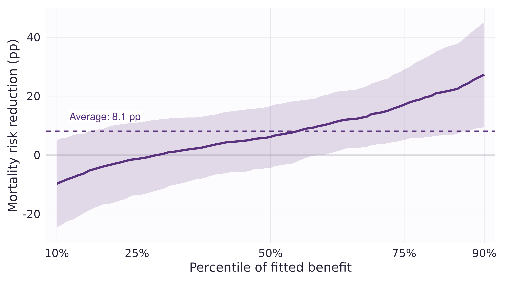{.panel-figure width=100%}
:::
::: {.column width="30%" .figure-notes}
- Shaded: a 95% band for the **whole curve**, not one point at a time.
- Near the bottom (10th percentile): **−9.8 pp**, band **−24.6 to +5.1**: we cannot tell whether these patients benefit.
- Average: **8.1 pp**, 95% CI **1.4 to 14.9**: clearly positive.
:::
:::

::: {.prompt}
The average benefit is clear; the shape of the spread is much less certain.
:::

::: notes
The band comes from the package's bootstrap (499 resamples) and covers the 10th–90th percentiles; why it is wider than pointwise intervals is on the next slide. It describes uncertainty about the curve, not a range for any individual patient.
:::

## Why is the band so wide? {#uniform-band}

$$
\widehat{\mathrm{SPE}}(u)\ \pm\ c\cdot\widehat{\mathrm{se}}(u), \qquad u=0.10,\,0.11,\,\ldots,\,0.90
$$

- **Pointwise** 95% interval: $c=1.96$. Right for one percentile; across 81 percentiles, some would miss.
- **Uniform** 95% band: $c$ covers all 81 at once. It is the 95th percentile of the **largest** standardized deviation across the 81, over 499 bootstrap refits.

| At the 10th percentile | $c$ | 95% interval (pp) |
|:--|--:|--:|
| Pointwise | 1.96 | `r interval(pointwise10)` |
| Uniform, whole curve | `r sprintf("%.2f", critical(spe_data))` | `r interval(band10)` |

::: {.source}
Uniform bands as in @chernozhukov2018 and SortedEffects; $\widehat{\mathrm{se}}$: bootstrap interquartile range ÷ 1.349. Constant-odds-ratio model: $c$ = `r sprintf("%.2f", critical(constant_spe))`. Band ends rearranged to stay monotone [@chernozhukov2009].
:::

::: notes
The constant-odds-ratio curve moves almost as one piece across bootstrap draws, so its critical value stays closer to 1.96. The pointwise interval is for comparison only. The band is the package's own bootstrap, which we reproduced independently; critical values are read off the saved bands. Uniform coverage concerns the chosen percentile grid and requires valid effect estimation and regularity conditions.
:::

## You find what your model allows {#model-comparison .figure-slide}

::: columns
::: {.column width="70%"}
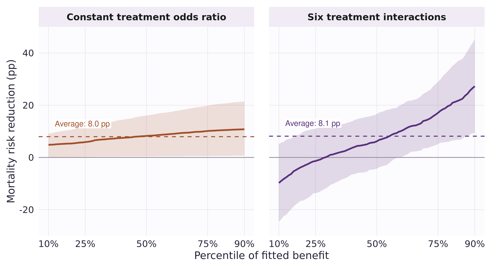{.panel-figure width=100%}
:::
::: {.column width="30%" .figure-notes}
- Constant odds ratio: benefit varies only with baseline risk, a narrow spread.
- Six interactions: a much wider spread.
- Same average (**8.0 vs 8.1 pp**); the six interactions improve the fit (p = .014).
- More spread is not proof: noise spreads too.
:::
:::

::: {.source}
95% bands for the whole curve, one per model.
:::

::: notes
The likelihood-ratio test assesses six treatment interactions on the log-odds scale; it is not a test of constant risk differences. The constant-odds-ratio model is risk-based heterogeneity; the six interactions are effect modeling (PATH comparison in chapter 04).
:::

## Does it hold up in new patients? {#held-out .figure-slide}

::: columns
::: {.column width="70%"}
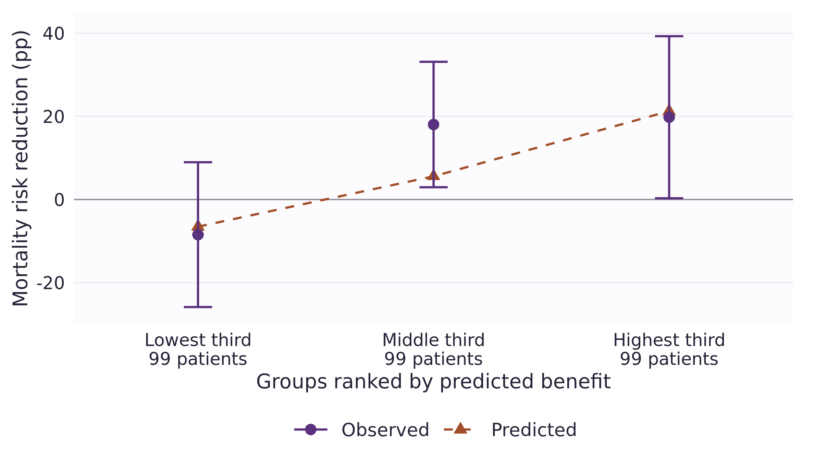{.panel-figure width=100%}
:::
::: {.column width="30%" .figure-notes}
- Fit on half the patients (296); rank the other half (297) blind to their outcomes.
- Higher-ranked patients did benefit more: slope **1.1** (1 = as predicted, 0 = no signal), p = .025.
- Lowest third: **−8.5 pp**, CI −25.9 to +9.0: again unclear.
:::
:::

::: {.source}
One random split, balanced by treatment arm; three groups of 99; a 95% interval for each group. p adjusted for checking two models.
:::

::: notes
The slope regresses held-out AIPW benefit pseudo-outcomes on centered predicted benefit (HC3 standard errors; Holm adjustment over the two planned rankings); tested against one, unadjusted p = .82. The top-minus-bottom tertile contrast is 28.3 pp (95% CI 2.1–54.4; Holm p = .068). These tertiles differ from the full-sample deciles, and one split is not independent replication.
:::

## What could fool us? {#robustness}

- **Noise looks like spread:** 19 parameters for 179 deaths; 60 patients per tail.
- **Missing data:** keeping all 618 patients moves the p-value for the interactions from **.014 to .054**.
- **One split, one trial:** colon was the third trial we tried (all three in chapter 04), with no adjustment for that search.

::: {.prompt}
A promising ranking to test in other trials, not a treatment rule.
:::

::: notes
The all-618 sensitivity uses a fixed node fill of two and missingness indicators; its average benefit is 8.4 pp. Both the model and the reference population differ from the complete-case analysis. Full sensitivity table in backup.
:::

# Discussion {#discussion .chapter-slide data-chapter-label="Discussion"}

::: {.chapter-number}
04
:::
::: {.chapter-lead}
What would make sorted effects useful in our own trials?
:::
::: {.chapter-cue}
↓ Three trials, lessons and questions
:::

## Three trials, three pictures {#three-trials .figure-slide .wide-figure}

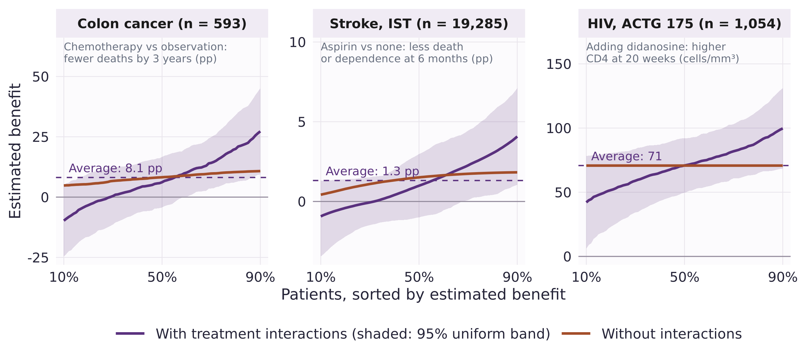{.panel-figure width=100%}

::: {.source}
Exploratory pilots, plans fixed before fitting; each band within its own model [@moertel1990; @ist1997; @hammer1996]. IST data: International Stroke Trial database v2 [@sandercock2011], doi:10.7488/ds/104, ODC-By 1.0.
:::

::: notes
IST was the primary pilot and ACTG 175 a secondary pilot alongside it; colon came third. IST: aspirin, death or dependence at six months, 19,285 patients with an observed outcome; the aspirin contrast averages over the factorial heparin allocation. ACTG 175: zidovudine plus didanosine versus zidovudine, CD4 count at 20 weeks, the public 1,054-row export of those two arms. No adjustment across trials. A linear model without interactions gives one constant effect, hence ACTG 175's flat line; logistic models spread absolute benefits even with a constant odds ratio. The IST bootstrap treats patients as independent and does not reflect hospital clustering. ACTG 175 therapies are historical. Plans: docs/ist-analysis-plan.md and docs/actg175-pilot.md.
:::

## Three trials in numbers {#three-trials-numbers}

```{r}
#| label: three_trials_table
#| results: asis
p_text <- function(p) sub("^0", "", ifelse(p < .1, sprintf("%.3f", p), sprintf("%.2f", p)))
spe_at <- function(d, u) d$estimate[abs(d$percentile - u) < 1e-9]
ist_spe <- read.csv("results/ist/interaction-spe.csv")
ist_ape <- read.csv("results/ist/interaction-ape.csv")
actg_spe <- subset(read.csv("results/actg175/spe.csv"), model == "interaction")
actg_ape <- subset(read.csv("results/actg175/ape.csv"), model == "interaction")
colon_test <- subset(read.csv("results/colon/interaction-test.csv"), scenario == "primary")
ist_test <- read.csv("results/ist/interaction-test.csv")
actg_test <- read.csv("results/actg175/interaction-test.csv")
colon_slope <- subset(read.csv("results/colon/validation-calibration.csv"),
                      term == "ranking_slope" & model == "interaction")
ist_slope <- subset(read.csv("results/ist/validation-calibration.csv"),
                    term == "ranking_slope" & model == "interaction")
actg_slope <- subset(read.csv("results/actg175/validation-calibration.csv"), model == "interaction")
ist_n <- subset(read.csv("results/ist/model-summary.csv"), model == "interaction")$n
actg_n <- subset(read.csv("results/actg175/model-summary.csv"), model == "interaction")$n
stopifnot(nrow(ist_spe) == 81L, nrow(actg_spe) == 81L, ist_n == 19285L, actg_n == 1054L)
pp_ci <- function(a) minus(sprintf("%.1f pp (%.1f to %.1f)", 100 * a$estimate, 100 * a$lower, 100 * a$upper))
pp_range <- function(d) minus(sprintf("%.1f to %.1f pp", 100 * spe_at(d, .1), 100 * spe_at(d, .9)))
knitr::kable(data.frame(
  Measure = c("Patients", "Average benefit (95% CI)", "10th to 90th percentile",
              "Interactions: terms, joint p", "Held-out ranking slope (p)"),
  Colon = c(format(nrow(patients), big.mark = ","), pp_ci(ape), pp_range(spe_data),
            sprintf("%d, p = %s", colon_test$df, p_text(colon_test$p_value)),
            sprintf("%.2f (p = %s)", colon_slope$estimate, p_text(colon_slope$p_holm_two_rankings))),
  IST = c(format(ist_n, big.mark = ","), pp_ci(ist_ape), pp_range(ist_spe),
          sprintf("%d, p = %s", ist_test$df, p_text(ist_test$p_value)),
          sprintf("%.2f (p = %s)", ist_slope$estimate, p_text(ist_slope$p_holm_two_rankings))),
  ACTG = c(format(actg_n, big.mark = ","),
           sprintf("%.0f cells/mm&sup3; (%.0f to %.0f)", actg_ape$estimate, actg_ape$lower, actg_ape$upper),
           sprintf("%.0f to %.0f cells/mm&sup3;", spe_at(actg_spe, .1), spe_at(actg_spe, .9)),
           sprintf("%d, p = %s", actg_test$numerator_df, p_text(actg_test$p_value)),
           sprintf("%.2f (p = %s)", actg_slope$estimate, p_text(actg_slope$p_null_zero)))),
  col.names = c("", "Colon cancer", "Stroke (IST)", "HIV (ACTG 175)"),
  align = c("l", "r", "r", "r"))
ist_risk_slope <- subset(read.csv("results/ist/validation-calibration.csv"),
                         term == "ranking_slope" & model == "constant")
```

::: {.prompt}
Every interaction curve slopes, but only colon's ranking held up in held-out patients, and colon was the third trial we looked at.
:::

::: {.source}
Interaction models; joint likelihood-ratio tests (colon, IST) or F test (ACTG 175). Held-out slope: 1 = as predicted, 0 = no signal; p for no signal, Holm-adjusted over two models for colon and IST.
:::

::: notes
In IST the simpler risk-based ranking did better in held-out patients: slope `r sprintf("%.1f", ist_risk_slope$estimate)` (unadjusted p = `r p_text(ist_risk_slope$p_zero)`, Holm p = `r p_text(ist_risk_slope$p_holm_two_rankings)`), whereas its interaction ranking showed no signal. ACTG 175 has only one ranking: its model without interactions predicts the same effect for everybody. Each slope regresses AIPW benefit pseudo-outcomes on predicted benefit in the held-out half: 297 patients for colon, 9,643 for IST and 527 for ACTG 175.
:::

## What did we learn? {#learned}

- The average (**8 pp**) hid a wide range of estimated benefits.
- Sorting turned a 19-parameter model into one curve and a profile of who sits at each end.
- The pattern is uncertain and depends on the model; in two other trials, similar curves did not hold up in new patients.

::: {.prompt}
Which result would convince you that the pattern is real?
:::

## Where do sorted effects fit? {#hte-tools}

| Approach | Question | Watch for |
|:--|:--|:--|
| Subgroup forest plot | Does the effect differ by one trait? | One trait at a time; many tests |
| Risk modeling | Does absolute benefit change with baseline risk? | Misses modifiers unrelated to risk |
| Effect modeling | Which traits modify the effect? | Overfitting; needs validation |
| Sorted effects + classification | How are fitted effects distributed, and who is in the tails? | Only as good as the effect estimates |

::: {.prompt}
Here, the constant-odds-ratio model is risk-based; the six interactions are effect modeling.
:::

::: {.source}
Risk and effect modeling as defined in the PATH statement [@kent2020].
:::

::: notes
PATH defines risk modeling (a multivariable risk model disaggregates trial patients by predicted risk) and effect modeling (treatment-by-covariate interactions); both predict absolute effects, which it calls the most relevant scale for clinical decisions. It encourages reporting results stratified by a risk model when the overall trial result is positive, as here. In IST, the risk-based ranking held up better in held-out patients than the interaction ranking. Our held-out slope is a calibration-for-benefit check; the c-for-benefit is a related discrimination measure [@vanklaveren2018].
:::

## Questions for discussion {#discussion-questions}

- **Spread or noise?** 29% of patients get a negative estimated benefit. Would you shrink the interactions first?
- **Planning:** would you prespecify sorted effects in a trial's analysis plan?
- **Risk or interactions:** start from baseline risk, or let the effect depend on traits?
- **Scale:** absolute or relative benefit?

::: notes
The 29% is a property of the fitted model, not an estimate of harm: the band at the 10th percentile still reaches +5.1 pp. Shrinkage options include penalized or Bayesian interaction models; their sorted summaries would need their own inference. Risk-based versus effect modeling: see the PATH slide. Treatment decisions would additionally require harms, preferences and policy-value assessment.
:::

## Next time: causal forests {#causal-forests}

- **Here:** we chose which interactions to allow.
- **Causal forests:** let the data choose. A tree splits patients where the effect differs most, say under and over 65; a forest averages many trees.
- **Same caveat:** neither method creates causality. Both need a design, here randomization.

::: {.source}
*The Effect*, §22.3.1 [@huntingtonklein2025]; generalized random forests [@athey2019]. No forest is fitted in this session.
:::

::: notes
The flexibility gain is relative to our specified regression; sorted effects can summarize other effect estimators. Forest pointwise intervals do not automatically provide uniform bands or inference for selected tails. SortedEffects itself does not accept a fitted forest. More intuition in backup.
:::

## Reading and materials {#reading}

- **Intuition:** *The Effect*, chapter 10 (treatment effects) and §22.3 (heterogeneous effects), free online [@huntingtonklein2025].
- **Method and software:** the sorted effects paper and the SortedEffects tutorial [@chernozhukov2018; @chen2020].
- **Risk versus effect modeling:** the PATH statement [@kent2020].
- **An application (suggested):** blood donors during the COVID-19 pandemic [@bilancini2022].
- **Code, report and slides:** [github.com/valentinklotzbuecher/jcod](https://github.com/valentinklotzbuecher/jcod).

# Additional material {#backup .chapter-slide .backup-chapter data-chapter-label="Backup"}

::: {.chapter-number}
\+
:::
::: {.chapter-lead}
Model code, the tail-bootstrap failure, full tables and assumptions.
:::
::: {.chapter-cue}
↓ Optional slides for questions
:::

## Backup · The model in R {#outcome-model .code-slide}

```{.r code-line-numbers="1-3|4-9|11"}
fm <- outcome ~ treatment + splines::ns(age, df = 3) + female +
  age_z:female + log_nodes + poor_diff + extensive +
  obstruct + adhere + surg_late +
  I((treatment == "chemotherapy") * age_z) +
  I((treatment == "chemotherapy") * female) +
  I((treatment == "chemotherapy") * age_z * female) +
  I((treatment == "chemotherapy") * log_nodes) +
  I((treatment == "chemotherapy") * poor_diff) +
  I((treatment == "chemotherapy") * extensive)

fit <- glm(fm, data = dat, family = binomial())
```

**1–3:** common model · **4–9:** six treatment interactions · **11:** fit the model.

::: {.source}
Comparison model: omit lines 4–9. `age_z = (age - 60) / 10`; `log_nodes = log1p(nodes)`.
:::

::: notes
The models have 13 and 19 parameters. Both use a three-degree-of-freedom age spline; treatment modification by age is linear. The six interactions were specified before fitting this pilot.
:::

## Backup · Predict both conditions in R {.code-slide}

```{.r code-line-numbers="1-3|5-6"}
control <- treated <- dat
control$treatment <- "observation"
treated$treatment <- "chemotherapy"

benefit <- predict(fit, control, type = "response") -
  predict(fit, treated, type = "response")
```

- Keep every patient's baseline characteristics fixed.
- Change only treatment assignment.
- Subtract predicted **risks**, not log odds.

::: notes
Both predictions use the same baseline profile. The contrast is standardized over the observed covariate distribution.
:::

## Backup · Why the package's tail bootstrap failed here {#native-ca}

- In each bootstrap resample, `ca()` refits the logistic model with weights scaled to sum to **20,000**.
- On these data, **141 of 499** refits did not converge, and **137** resamples gave undefined tail means.
- The function still printed normal-looking SEs and p-values. We do not use them.
- Our re-run starts each refit from stable values: **all 499** refits converge, and none are dropped.

::: {.prompt}
Check every bootstrap refit: output that looks normal can still be wrong.
:::

::: {.source}
Same resamples, model, tail definitions and tail means; only the numerical starting point changed. Details in the colon report.
:::

::: notes
Scaling the weights leaves the weighted maximum-likelihood solution unchanged, but it can derail R's default starting values for glm. Empty tails produced undefined means, and the package's handling of those invalid resamples distorted the joint p-values. The raw output is kept separately in classification-native.csv; the re-run is in classification-stabilized.csv.
:::

## Backup · Calculate tail means {.code-slide}

```{.r code-line-numbers="1-3|4-5|6-8"}
cutoff <- Hmisc::wtd.quantile(
  benefit, rep(1, nrow(dat)), c(.10, .90)
)
tails <- list(low = benefit <= cutoff[1],
              high = benefit >= cutoff[2])
traits <- colon_characteristics()$variable
lapply(tails, function(i)
  colMeans(dat[i, traits]))
```

- Select tails by fitted benefit, then summarize baseline characteristics.
- Both tails can contain patients from either randomized arm.

::: {.source}
Descriptive calculation only. `R/colon-walkthrough.R` verifies these means against the saved classification table.
:::

## Backup · Classification: demographics and nodes {.compact-table}

```{r}
#| label: demographic_table
#| results: asis
ca_table(c("age", "female", "old_men", "younger_women", "nodes", "nodes_over4"))
```

Difference = high − low. Percentages differ in percentage points.

::: {.source}
60 patients per tail. SEs and p-values from our checked re-run of the tail bootstrap (stable starting values, 499 resamples); p-values adjusted across all twelve traits, not just these six.
:::

## Backup · Classification: clinical characteristics {.compact-table}

```{r}
#| label: clinical_table
#| results: asis
ca_table(c("poor_diff", "extensive", "obstruct", "perfor", "adhere", "surg_late"))
```

Difference = high − low, in percentage points.

::: {.source}
“Long surgery interval”: surgery-to-registration category. SEs and p-values from our checked re-run of the tail bootstrap, adjusted across all twelve traits.
:::

## Backup · What is resampled?

- **`spe()`:** refits the model in each resample, then sorts the predicted effects for the original 593 patients.
- **`ca()`:** refits the model in each resample, recomputes who falls in each tail, and recomputes the tail means.
- **Held-out check:** fits on one half only, freezes the ranking, then looks at outcomes in the other half.

## Backup · Cohort and sensitivity checks

| Analysis | Patients | Average benefit | Interaction p |
|:--|--:|--:|--:|
| Complete baseline and endpoint | 593 | 8.1 pp | .014 |
| Missing baseline values with indicators | 618 | 8.4 pp | .054 |
| Early-censored outcome assigned 0 | 594 | 8.0 pp | .017 |
| Early-censored outcome assigned 1 | 594 | 8.4 pp | .010 |

- The latter two retain complete baseline variables.
- Eight records disagree on the supplied vs count-derived four-node indicator; the report includes a coding check.

::: notes
The primary model uses continuous log node count. The separate coding check compares two binary-node models; it does not replace the primary specification.
:::

## Backup · The other two trial pilots {#other-pilots .compact-table}

| | Stroke (IST) | HIV (ACTG 175) |
|:--|:--|:--|
| Comparison | Aspirin vs none, averaged over heparin | Zidovudine + didanosine vs zidovudine |
| Outcome | Death or dependence at 6 months | CD4 count at 20 weeks |
| Models | Logistic: constant odds ratio vs 8 interactions | Linear: main effects vs 8 interactions |
| Effect may vary with | Age, sex, age × sex, blood pressure, delay, consciousness, atrial fibrillation, leg deficit | Age, sex, weight, CD4, CD8, Karnofsky score, symptoms, prior antiretrovirals |
| Watch for | Bootstrap ignores hospital clustering; 150 missing outcomes | Public export of two arms; historical therapies |

::: {.source}
Plans recorded before fitting: `docs/ist-analysis-plan.md`, `docs/actg175-pilot.md`; full IST report on the session page. Native SortedEffects 1.7.0 inference, 499 draws, one held-out split each.
:::

## Backup · When is the heterogeneity causal?

- **Identification, both:** randomization or no unmeasured confounding; overlap; consistency/no interference; appropriate handling of selection and missing data.
- **Regression → sorted effects and tail comparison:** reliable conditional-risk estimates; suitable convergence and regularity of the effect distribution.
- **Forests:** enough local data, regularity, suitable nuisance estimates and honest fitting.
- **Inference:** pointwise forest intervals do not automatically cover sorted effects or selected tails.

::: {.source}
Both concern conditional average effects. Fitted spread alone does not establish true heterogeneity. [@chernozhukov2018; @athey2019]
:::

::: notes
Effect-quantile inference requires suitable estimator convergence and regularity at the requested quantiles. The discrete warm-up illustrates the estimand, not a coverage result. Randomization does not automatically justify complete-case selection.
:::

## Backup · How a forest builds a comparison {#forest-intuition}

For a patient profile, which treated and control patients are comparable?

::: {.sorting-steps}
::: {.fragment .fade-up}
**1 · Grow a tree**

Split baseline profiles to find groups with different treatment–control contrasts.
:::
::: {.fragment .fade-up}
**2 · Grow many trees**

Different samples and candidate splits give different groups of similar patients.
:::
::: {.fragment .fade-up}
**3 · Combine the comparisons**

Patients repeatedly grouped with the target profile get more weight in its treatment comparison.
:::
:::

::: {.prompt}
Many trees reduce dependence on any one noisy split.
:::

::: {.source}
“Honest” fitting uses separate observations to choose splits and estimate effects. Randomized-trial intuition; no forest was fitted here. [@athey2019]
:::

::: notes
Shared leaves define adaptive-neighbor weights, normalized for leaf size. GRF uses them in a local estimating equation, rather than simply averaging raw leaf risk differences. Honesty separates split selection from within-tree estimation. grf's treated-minus-control convention would need reversing for mortality benefit.
:::

## Backup · Original published example

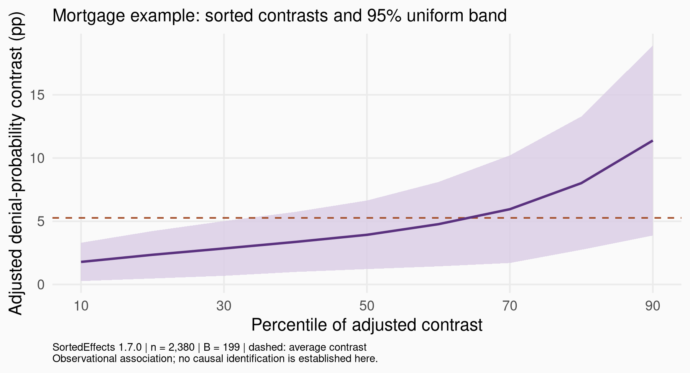{width=95%}

::: {.source}
Tutorial benchmark: adjusted observational disparity [@chen2020; @munnell1996].
:::

::: notes
Published tutorial: bias-corrected disparity 5.1 pp, 90% CI 2.1–8.1, 500 draws. The retained benchmark uses uncorrected estimates, 95% bands and 199 draws.
:::

## References {.references-slide .scrollable .allowframebreaks}

::: {#refs}
:::
