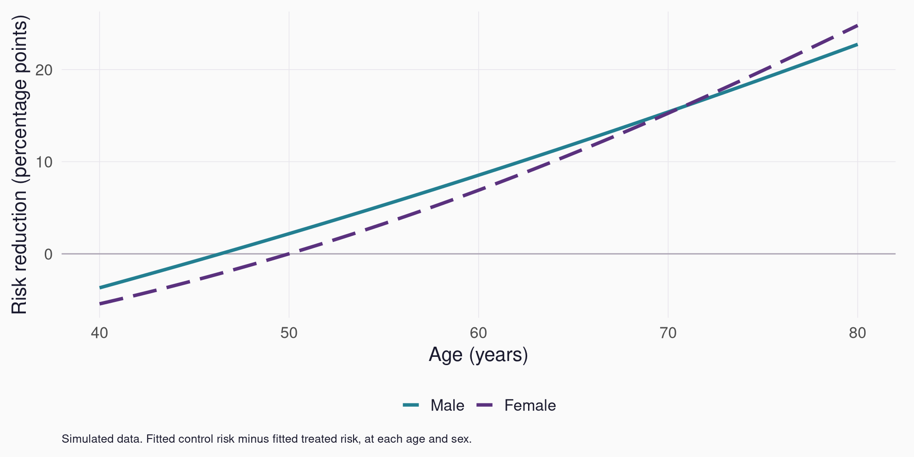

```{r}
#| label: session_data
#| include: false
required <- paste0("results/example-", c("spe", "inference", "ape", "profiles"), ".csv")
if (!all(file.exists(required))) {
  stop("Generate results: Rscript R/demo.R; Rscript scripts/example-inference.R")
}
spe_data <- read.csv(required[1])
classification <- read.csv(required[2])
ape <- read.csv(required[3])
profiles <- read.csv(required[4])
age_tail <- classification[classification$characteristic == "age", ]
low_profile <- profiles[which.min(profiles$age), , drop = FALSE]
high_profile <- profiles[which.max(profiles$age), , drop = FALSE]
pp <- function(x) sprintf("%.1f", 100 * x)
risk <- function(x) sprintf("%.1f%%", 100 * x)
q80 <- spe_data$estimate[which.min(abs(spe_data$percentile - .80))]
```

## Session overview {#session-map .map-slide data-transition="fade"}

::: {.content-visible when-format="revealjs"}
::: {.session-map}
::: {.map-card}
[01 · Literature](#literature){.map-title}

The method and the R package.
:::
::: {.map-card}
[02 · Example](#example){.map-title}

Treated, control, age and sex.
:::
::: {.map-card}
[03 · Sorted effects](#distribution){.map-title}

From predicted risks to a distribution.
:::
::: {.map-card}
[04 · Classification](#classification){.map-title}

Compare the low- and high-effect groups.
:::
::: {.map-card}
[05 · Inference](#uncertainty){.map-title}

Confidence bands and group comparisons.
:::
::: {.map-card}
[06 · Discussion](#discussion){.map-title}

What would we use this for?
:::
:::

::: {.key-hint}
**→** chapters · **↓** slides within a chapter · **Space** next step · **Esc** overview
:::
:::

::: {.content-visible when-format="beamer"}
1. Literature and software.
2. A simulated treated/control example with age and sex.
3. Sorted effects and comparisons of the tails.
4. Inference and discussion.
:::

::: notes
One hour including discussion. Allow about 35–40 minutes for prepared material. The example is generic: randomized treatment, a binary adverse outcome, age and sex. Every main figure uses the same fitted model and observed profiles. Show the R snippets to explain the calculation without teaching every argument. Horizontal navigation moves between chapters; vertical navigation adds detail. Use the map to return to figures during discussion.
:::

# Literature {#literature .chapter-slide data-chapter-label="Literature" data-background-color="#261b37" data-background-transition="fade"}

::: {.chapter-number}
01
:::

::: {.chapter-lead}
The average effect is useful. What else can we learn from the same model?
:::

::: {.chapter-cue}
↓ The method and its R implementation
:::

## Two starting points

- **Method:** Chernozhukov, Fernández-Val and Luo (2018), *Econometrica* [@chernozhukov2018].
- **Applied tutorial:** Chen et al. (2020), *The R Journal* [@chen2020].

::: {.sorting-steps}
::: {.fragment .fade-up}
**Average effect**

How large is the effect on average?
:::
::: {.fragment .fade-up}
**Sorted effects**

How much do the fitted effects vary?
:::
::: {.fragment .fade-up}
**Classification**

What characterizes the low and high tails?
:::
:::

::: notes
0–3 minutes. The original method summarizes a partial-effect function: a finite contrast for treatment or a derivative for a continuous exposure. The R tutorial is the most accessible preparation reading. Sorting summarizes effects estimated by a model; it does not identify causal effects on its own. The tutorial's mortgage example is in backup as a software benchmark.
:::

## What the R package provides

::: columns
::: {.column width="48%" .profile-card}
### `spe()`

An estimated effect distribution and average effect, with **bootstrap confidence bounds**.
:::
::: {.column width="48%" .profile-card}
### `ca()`

Comparisons of tail characteristics, with **bootstrap standard errors and joint p-values**.
:::
:::

We use **SortedEffects 1.7.0** for the main results.

::: notes
3–4 minutes. Yes, inference is implemented in the package. The main figures use its actual spe() and ca() outputs. For moment comparisons, ca() returns SEs and joint adjusted p-values, but no ready-made moment confidence intervals. The dumbbell connecting lines will therefore remain descriptive. The source version and numerical checks are documented in the repository.
:::

# Example {#example .chapter-slide data-chapter-label="Example" data-background-color="#261b37" data-background-transition="fade"}

::: {.chapter-number}
02
:::

::: {.chapter-lead}
A binary outcome, two treatment groups, and two baseline characteristics.
:::

::: {.chapter-cue}
↓ Define the effect before summarizing it
:::

## A simple simulated dataset

- **5,000 observations**, randomized to **treated** or **control**.
- Binary outcome: **1 = an adverse event**.
- Baseline variables: **age** (40–80 years) and **sex**.
- Treatment effects are allowed to vary with age and sex.

::: {.prompt}
We will work with the reduction in event risk, in percentage points.
:::

::: {.source}
Simulated data throughout. The age and sex patterns illustrate the method; they are not empirical findings.
:::

::: notes
4–6 minutes. No disease, treatment or follow-up period is named; real applications need all three specified. Age_z is age centered at 60 and divided by 10. Sex is simulated and coded 0 male, 1 female. This simplified coding is for the example, not a statement about measuring sex or gender in every study. Randomization and treatment support hold by construction. The full treatment-by-age-by-sex model matches the simulation.
:::

## Predict both treatment conditions {#same-treatment data-auto-animate="true"}

Two ages, with sex held fixed (male).

::: columns
::: {.column width="48%" .profile-card .fragment .fade-up fragment-index="0" data-id="profile-low"}
### Age 50

`r risk(low_profile$risk_control)` → `r risk(low_profile$risk_treated)` event risk

Control → treated
:::
::: {.column width="48%" .profile-card .fragment .fade-up fragment-index="1" data-id="profile-high"}
### Age 70

`r risk(high_profile$risk_control)` → `r risk(high_profile$risk_treated)` event risk

Control → treated
:::
:::

::: {.prompt .fragment .fade-up fragment-index="2"}
Subtract the treated risk from the control risk.
:::

::: notes
6–8 minutes. These profiles are evaluated with the same model used later. They are predicted probabilities, not paired observed outcomes. Read the control and treated risks before revealing their differences. Every profile is predicted under both conditions, regardless of actual assignment.
:::

## The effect on the absolute scale {#absolute-benefits data-auto-animate="true"}

**Risk reduction = control risk − treated risk.**

::: columns
::: {.column width="48%" .profile-card data-id="profile-low"}
### Age 50

::: {.metric}
`r pp(low_profile$benefit)` pp
:::

`r risk(low_profile$risk_control)` → `r risk(low_profile$risk_treated)`
:::
::: {.column width="48%" .profile-card data-id="profile-high"}
### Age 70

::: {.metric}
`r pp(high_profile$benefit)` pp
:::

`r risk(high_profile$risk_control)` → `r risk(high_profile$risk_treated)`
:::
:::

- **Positive:** lower event risk under treatment.
- **Negative:** higher event risk under treatment.

::: notes
Keep the effect scale and sign consistent. A percentage point is an absolute difference between probabilities. These estimates describe average responses for a covariate profile, not an individual's realized treatment effect. All values are generated from the fitted model.
:::

## What effect are we estimating?

$$
\Delta(x)=\Pr(Y=1\mid A=0,X=x)-\Pr(Y=1\mid A=1,X=x).
$$

- $A=0$: control; $A=1$: treated; $X$: age and sex.
- One **conditional average risk reduction** for each profile.
- The distribution of profiles defines the population we summarize.

::: notes
8–10 minutes. Under randomization and consistency, this conditional average contrast has a causal interpretation. Observational applications require a credible identification argument and adequate support. Sorting does not supply those assumptions. We summarize the observed 5,000 profiles; a different reference population could have a different mean and SPE curve even with the same conditional model.
:::

# Estimated effects {#distribution .chapter-slide data-chapter-label="Effects" data-background-color="#261b37" data-background-transition="fade"}

::: {.chapter-number}
03
:::

::: {.chapter-lead}
Fit the model, predict both conditions, then summarize the risk differences.
:::

::: {.chapter-cue}
↓ R code and the sorted-effects curve
:::

## Fit the outcome model {.code-slide}

```{.r code-line-numbers="1|2"}
fm <- outcome ~ group * age_z * sex
fit <- glm(fm, data = dat, family = binomial())
```

- `group` has levels `control` and `treated`.
- `age_z = (age - 60) / 10`; `sex`: 0 = male, 1 = female.
- The interactions allow treatment effects to vary with age and sex.

::: notes
10–12 minutes. The star expands to main effects and all two- and three-way interactions: the age pattern of the treatment log odds ratio can differ by sex. Risk differences can also vary when an odds ratio is constant. Explain the interactions without reading every coefficient. Real age patterns may need a more flexible model. Executable code is in R/example-walkthrough.R; dat here is its data object.
:::

## Predict the two risks {.code-slide}

```{.r code-line-numbers="1-3|5-6"}
control <- treated <- dat
control$group <- "control"
treated$group <- "treated"

benefit <- predict(fit, control, type = "response") -
  predict(fit, treated, type = "response")
```

- Keep age and sex fixed for each row.
- Change only the treatment assignment.
- `benefit` contains one predicted risk difference per row.

::: notes
12–14 minutes. Response gives probabilities rather than log odds. We standardize using observed profiles, rather than subtracting observed outcomes from different arms. The package's categorical comparison is ordered to give the same sign and checked against direct predictions.
:::

## Before sorting: effects by age and sex {.figure-slide}

::: columns
::: {.column width="70%"}
{.panel-figure width=100%}
:::
::: {.column width="30%" .figure-notes}
- Each line shows fitted **risk reduction** at a given age and sex.
- Risk reduction rises with age in both simulated sex groups.
- Zero means equal predicted risks under treated and control.
- Next, combine all observed profiles and sort their effects.
:::
:::

::: {.source}
Same model and scale as the following SPE curve. These demographic patterns are simulated.
:::

::: notes
14–16 minutes. Start with the familiar covariate scale. Each line is a conditional average contrast. Sorting pools both sexes at their observed frequencies and keeps effect values while removing the age/sex labels from the axes. Compare this with SPE when discussing what sorting adds to an interaction plot. The strong age pattern and smaller sex difference are generated for teaching.
:::

## Calculate percentiles and the mean {.code-slide}

```{.r code-line-numbers="1-4|5"}
u <- seq(.10, .90, by = .01)
spe_curve <- Hmisc::wtd.quantile(
  benefit, weights = rep(1, nrow(dat)), probs = u
)
mean(benefit)
```

- **SPE curve:** a percentile summary of the fitted effects.
- **Average effect:** the mean over all 5,000 profiles.

::: {.source}
Equal profile weights. The weighted-quantile convention matches SortedEffects 1.7.0.
:::

::: notes
16–17 minutes. Conceptually, order the contrasts and read percentiles. Hmisc matches the package's weighted convention. The average is neither the median nor the mean of the displayed 10th–90th percentile grid. Avoiding extreme tails can help stability.
:::

## The sorted-effects curve {.figure-slide}

::: columns
::: {.column width="70%"}
{.panel-figure width=100%}
:::
::: {.column width="30%" .figure-notes}
- **Horizontal:** percentile of fitted risk reductions.
- **Vertical:** risk reduction in percentage points.
- Dashed line: mean of **`r pp(ape$estimate)` pp**.
- Sorting shows the spread; it removes the age and sex labels.
:::
:::

::: notes
17–20 minutes. The curve increases because it is sorted, not because percentile causes a larger treatment effect. Spread describes variation in fitted conditional effects; uncertainty comes next. Package estimates are uncorrected to match direct calculations. Ask what the mean hides.
:::

## How to read one point

At the **80th percentile**, estimated risk reduction is **`r pp(q80)` pp**.

- About **80% of profiles** have fitted reductions at or below this value.
- About **20%** have larger fitted reductions.
- This is a percentile **of effects**, not an effect on an outcome percentile.

::: {.prompt}
It does not mean that an individual has an 80% chance of benefiting.
:::

::: notes
20–21 minutes. Distinguish SPE from a quantile treatment effect. We sort conditional mean contrasts, not realized individual effects. Empirical proportions are approximate because of quantile interpolation.
:::

# Classification {#classification .chapter-slide data-chapter-label="Classification" data-background-color="#261b37" data-background-transition="fade"}

::: {.chapter-number}
04
:::

::: {.chapter-lead}
Which profiles have the smallest and largest estimated risk reductions?
:::

::: {.chapter-cue}
↓ Compare the bottom and top 10%
:::

## Describe the two tails {.code-slide}

```{.r code-line-numbers="1-3|4-7"}
cutoff <- Hmisc::wtd.quantile(
  benefit, rep(1, nrow(dat)), c(.10, .90)
)
tails <- list(low = benefit <= cutoff[1],
              high = benefit >= cutoff[2])
lapply(tails, function(i)
  colMeans(dat[i, c("age", "sex")]))
```

- Select groups using **estimated effects**, then summarize their covariates.
- Each tail contains about 500 observations.
- Both tails can include observations from either treatment arm.

::: notes
21–23 minutes. Tail groups are not treated/control arms or outcome groups. Sex is 0/1, so its mean is the female proportion. The package uses thresholds; ties can alter group sizes. There are no relevant ties here. This step is descriptive; formal inference follows.
:::

## Comparing the tails with dumbbells {.figure-slide}

::: columns
::: {.column width="70%"}
{.panel-figure width=100%}
:::
::: {.column width="30%" .figure-notes}
- Endpoints: means in the **bottom and top 10%** of fitted effects.
- Mean age: **`r sprintf("%.0f", age_tail$least_mean)` vs `r sprintf("%.0f", age_tail$most_mean)` years**. Sex composition is less clearly separated.
- The line shows a group difference, **not a confidence interval**.
- These are descriptions of the fitted model's tails.
:::
:::

::: notes
23–26 minutes. Read the legend, then the direction. Distances across panels are not standardized effect sizes. Age differs greatly; the smaller sex gap will prove uncertain after refitting and reclassification. Relate this to the age-by-sex plot. A tail characteristic difference is not an independent discovery of effect modification or a treatment interaction test.
:::

# Inference {#uncertainty .chapter-slide data-chapter-label="Inference" data-background-color="#261b37" data-background-transition="fade"}

::: {.chapter-number}
05
:::

::: {.chapter-lead}
How much could the curve and group comparisons change in another sample?
:::

::: {.chapter-cue}
↓ Bootstrap inference in SortedEffects
:::

## Obtain a confidence band with `spe()` {.code-slide}

```{.r code-line-numbers="1-5|6"}
spe_fit <- SortedEffects::spe(
  fm = fm, data = dat, method = "logit",
  var_type = "categorical", var = "group",
  compare = c("treated", "control"),
  us = u,
  b = 499, alpha = .05, bc = FALSE, seed = 420
)
```

- Returns the curve, average effect and **bootstrap uncertainty**.
- This order of `compare` gives **control minus treated**.

::: notes
26–28 minutes. The package calculates prediction(compare[2]) minus prediction(compare[1]). This is the actual call used for the figures. 499 draws are adequate for an illustration; assess Monte Carlo precision in a serious analysis. bcFALSE keeps uncorrected point estimates. The procedure refits and re-sorts; source inspection and independent reconstruction check the actual resampling behavior.
:::

## Uncertainty in the sorted curve {.figure-slide}

::: columns
::: {.column width="70%"}
{.panel-figure width=100%}
:::
::: {.column width="30%" .figure-notes}
- Shading: **95% uniform confidence band** over the displayed grid.
- The lower-tail band crosses zero; the upper-tail band stays above zero.
- The band concerns the **curve**, not an individual's treatment effect.
:::
:::

::: {.source}
SortedEffects 1.7.0; 499 bootstrap draws; 10th–90th percentiles; uncorrected estimates.
:::

::: notes
28–30 minutes. Uniform means joint coverage over the requested grid under the method's assumptions. The full-sample spe() path resamples training weights but retains original profile weights for effect quantiles. The displayed uncertainty conditions on that empirical distribution. A band is not a dedicated test of homogeneous effects and does not account for model misspecification.
:::

## Compare tail characteristics with `ca()` {.code-slide}

```{.r code-line-numbers="1-4|5-8"}
ca_fit <- SortedEffects::ca(
  fm = fm, data = dat, method = "logit",
  var_type = "categorical", var = "group",
  compare = c("treated", "control"),
  u = .10, interest = "moment", cl = "diff",
  t = c("age", "sex"),
  b = 499, alpha = .05, bc = FALSE, seed = 420
)
```

Compares **mean age** and **female proportion** between the top and bottom tails.

::: notes
30–32 minutes. ca() refits, updates thresholds and recomputes group characteristics. Its moment path also reweights thresholds and means, unlike the SPE path. We request high-minus-low differences for two traits. Report native SEs and joint adjusted p-values; no native moment confidence intervals are claimed.
:::

## Uncertainty in the tail differences

```{r}
#| label: classification_inference_table
selected <- classification[match(c("age", "sex"), classification$characteristic), ]
scale <- c(1, 100)
inference_table <- data.frame(
  Characteristic = c("Age (years)", "Female (percentage points)"),
  `Top minus bottom` = sprintf("%.2f", selected$difference * scale),
  `Bootstrap SE` = sprintf("%.2f", selected$standard_error * scale),
  `Joint p` = format.pval(selected$joint_p, digits = 2, eps = .01),
  check.names = FALSE
)
knitr::kable(inference_table, row.names = FALSE)
```

- **Age:** a large, well-supported difference in this simulation.
- **Sex:** the apparent gap is uncertain after refitting and reclassification.
- Joint p-values adjust across the **two requested characteristics**.

::: {.source}
Native `ca()` output; 499 draws. Displayed p < .01 is rounded Monte Carlo output. These are comparisons of tail profiles, not subgroup treatment-effect tests.
:::

::: notes
32–34 minutes. Female differences are proportion differences multiplied by100. Its large SE reflects changes in tail composition when two close sex curves are re-estimated. The joint maximum-statistic adjustment covers the supplied traits, not all exploratory choices. Native pointwise_p is not a usual two-sided normal-tail p-value and is not used here. See docs/example-inference.md. Native SEs and p-values are independently reconstructed. Monte Carlo zero is not an exactly zero population probability. Numerical checks do not establish coverage.
:::

## What the bootstrap does not settle

- **Identification:** is a causal interpretation justified by the design?
- **Model:** are conditional risks and interactions estimated well?
- **Population:** are these the profiles we want to summarize?
- **Analysis choices:** how sensitive are results to the model and tail cutoffs?

::: notes
34–35 minutes. Here treatment is randomized and the model correctly specified. In practice, check flexible age effects, calibration and support, and account for clustering or other design structure. Near-flat or degenerate effect distributions can complicate quantile inference. Bootstrap uncertainty cannot validate the model or transport results to another population.
:::

# Discussion {#discussion .chapter-slide data-chapter-label="Discussion" data-background-color="#261b37" data-background-transition="fade"}

::: {.chapter-number}
06
:::

::: {.chapter-lead}
When would this be more useful than an interaction plot or a subgroup table?
:::

::: {.chapter-cue}
↓ Applications and limitations
:::

## What sorted effects add

- A summary of the **spread** of fitted effects, alongside the average.
- A way to compare tails without defining every subgroup in advance.
- Descriptions of the **profiles** in those tails, with inference.

::: {.prompt}
Using the ranking to choose treatment needs a separate evaluation of benefits, harms and decision rules.
:::

::: notes
35–37 minutes. The age-by-sex interaction plot is already informative in this small example. SPE is particularly useful when many covariates jointly determine effects. It simplifies the distribution but loses covariate labels, hence classification. A treatment rule needs independent evaluation, preferably out of sample, and suitable outcomes and harms. Ranking alone does not establish a useful policy.
:::

## Questions for discussion

1. Where would a distribution of effects help in our own work?
2. What would SPE add to the analyses we already use?
3. Which model checks and sensitivity analyses would we require?
4. Would the bottom and top 10% be useful groups for that application?

::: {.source}
Use the map to return to the age-by-sex plot, SPE curve, dumbbells or inference table.
:::

::: notes
37–60 minutes, allowing for questions already asked. Other prompts: absolute or relative effects? Standardization to a different age/sex distribution? Overfitting? Is tail selection useful if everyone has enough net benefit to justify treatment? How would many covariates or unmeasured modifiers change interpretation? Keep the focus applied.
:::

## Reading and reproducible code

- **Preparation:** Chen et al. (2020), *SortedEffects: Sorted Causal Effects in R* [@chen2020]. Introduction and worked example.
- **Optional theory:** Chernozhukov, Fernández-Val and Luo (2018) [@chernozhukov2018].
- **Repository:** slides, executable R code, results and checks at [github.com/valentinklotzbuecher/jcod](https://github.com/valentinklotzbuecher/jcod).

::: notes
End of main material. The R Journal tutorial is sufficient preparation for the applied discussion; the Econometrica paper is optional theory. All main results are simulated. Additional details and the separate mortgage benchmark follow in backup.
:::

# Additional material {#backup .chapter-slide .backup-chapter data-chapter-label="Backup" data-background-color="#261b37" data-background-transition="fade"}

::: {.chapter-number}
\+
:::

::: {.chapter-lead}
Definitions, sensitivity diagnostics and software checks.
:::

::: {.chapter-cue}
↓ Optional slides for questions
:::

## Backup · What is being sorted?

$$
\mathrm{SPE}(u)=Q_{\Delta(X)}(u), \qquad
\mathrm{APE}=E[\Delta(X)].
$$

- The distribution of $X$ defines the population being summarized.
- Classification describes baseline characteristics in selected effect tails.
- A quantile of effects differs from a difference of outcome quantiles.

::: {.source}
[@chernozhukov2018]. Estimates use the package's weighted empirical quantile convention.
:::

::: notes
The paper studies estimated effect functions and classification under regularity conditions. Conditional means are not realized individual causal effects. APE is the full-population average, not the area under the displayed truncated curve. A different reference distribution changes the sorted summary.
:::

## Backup · Effect scale matters

{width=95%}

::: {.source}
A constant odds ratio of 0.60 still gives varying absolute risk reductions. Separate analytic illustration.
:::

::: notes
For OR theta and control risk p, treated risk is theta*p/(1-p+theta*p). Absolute benefit peaks at1/(1+sqrt(theta)); it is not globally increasing. Risk-difference heterogeneity can arise without log-odds interaction. This is a scale property, not evidence for a biological mechanism.
:::

## Backup · Simulation assumptions

- Baseline event risk depends on age, sex and their interaction.
- The treatment log odds ratio also depends on age, sex and their interaction.
- The fitted model matches the data-generating specification.
- The 5,000 observed profiles define the primary SPE reference distribution.

::: {.source}
R/demo.R contains coefficients, seed and diagnostics. A matched-average constant-OR scenario is retained for software exercises.
:::

::: notes
A favorable simulation with known truth and correct models does not demonstrate robustness to misspecification. The treatment intercept is calibrated to match the true average in the optional constant-OR scenario. Only the age-by-sex interaction scenario appears in the main talk. All demographic patterns are generated for teaching.
:::

## Backup · Tail membership after refitting {.figure-slide}

::: columns
::: {.column width="70%"}
{.panel-figure width=100%}
:::
::: {.column width="30%" .figure-notes}
- Each position is a profile in the original top 10%.
- Vertical position: how often it stays in the top 10% after refitting.
- Profiles near a cutoff can change groups.
- Frequencies are sensitivity summaries, not membership probabilities.
:::
:::

::: {.source}
Separate teaching bootstrap, distinct from formal package classification inference.
:::

::: notes
This diagnostic holds prediction profiles fixed. It differs from native ca() moment inference and the paper's confidence sets for classification. Frequencies are not calibrated probabilities of individual true membership. Skip this unless stability comes up in discussion.
:::

## Backup · What is resampled?

- **`spe()` full sample:** refits with bootstrap weights; effect quantiles retain original profile weights.
- **`ca()` moments:** refits and updates thresholds and characteristic means with resampled weights.
- **Membership diagnostic:** separate fixed-profile refit-and-reclassify calculation.

::: notes
These are the inspected behaviors of version1.7.0 documented in docs/example-inference.md. Do not claim SPE and CA condition on exactly the same empirical distribution. External standardization or clustering needs suitable handling. Native IQR/max uniform bands are used in the main slides; custom SD/max teaching bands remain separate outputs.
:::

## Backup · Interpreting `ca()` output

- `interest = "moment", cl = "diff"` compares high- minus low-effect characteristic means.
- Joint p-values adjust across the **specified characteristics**.
- Bootstrap SEs and joint p-values are returned for these differences.
- Native moment confidence intervals are not returned by this call.

::: notes
Native pointwise_p is not a usual doubled normal-tail p-value and is not used. The joint maximum-statistic calculation is checked separately. Adjustment does not cover every exploratory model or tail size. A small classification p-value is not an interaction or policy-value test. Zero means0/499bootstrap maxima exceeded the observed statistic, not an exactly zero population probability or rigorous bound below1/499.
:::

## Backup · Original published example

{width=95%}

::: {.source}
Mortgage data from the tutorial [@chen2020; @munnell1996]. Separate original-package benchmark.
:::

::: notes
The tutorial reports a bias-corrected adjusted denial disparity of5.1pp with90%interval2.1–8.1using500draws. This benchmark uses199draws, uncorrected estimates and95%bands. Direct point estimates and independently reconstructed SPE bands match to numerical precision. The race contrast is an adjusted observational disparity; causality requires additional assumptions. Native plotting succeeds on this runtime; no estimator source was changed.
:::

## References {.references-slide}

::: {#refs}
:::
